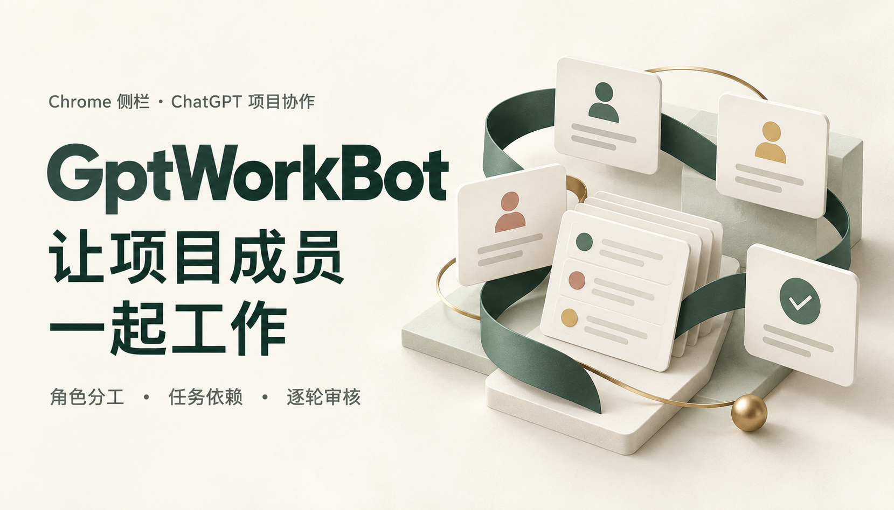
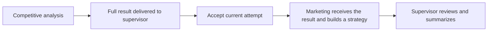

# GptWorkBot

**Organize your ChatGPT project's Work chats into a team with clear roles, visible dependencies and review at each round.**

A Chrome side-panel extension for individual developers. Give the supervisor chat a goal, review the plan and results in the sidebar, and let roles continue in dependency order. Keep existing project context and responsibilities. No additional API key or separate coordination backend is required.

**1.0.0 · Chrome 120+ · Chinese / English · Existing ChatGPT login · Testing release**

[简体中文](README.md) · [Download](https://github.com/dickenson258/GptWorkBot/releases/tag/v1.0.0) · [Getting started](#getting-started) · [Documentation](docs/README.en.md)

## Make collaboration easier to follow

- **Task dependencies:** the supervisor plans the full chain upfront. Independent work may run in parallel. Dependent tasks wait for a complete prerequisite result to reach the supervisor and pass acceptance of the current attempt, then receive that result automatically.
- **Role responsibilities:** bind existing chats or create Work roles in the current project. Configure a name, responsibilities, an optional first task and acceptance criteria.
- **Review each round:** approve the plan before dispatch by default. Edit tasks and prerequisites while they are drafts; approved dependencies stay fixed. The supervisor can request revisions of the original task while preserving result history.

The team chart uses **green for idle, red for running and yellow for interaction needed**. Gray means disconnected or stale. A role waiting on normal prerequisites stays idle; the sidebar explains whether it is waiting for completion, report delivery or acceptance.

## Start with one dependency chain

Give the supervisor a goal:

> Analyze product competitiveness and competitor strengths and weaknesses, then have marketing build a strategy from the accepted analysis. Plan the full chain upfront.



Approving the round does not start marketing early. If analysis needs revision, the supervisor guides the original task and downstream work keeps waiting. The revised result must reach the supervisor and pass acceptance before the next task starts.

## Interface previews

<table>
  <tr><th>Team and tasks</th><th>Roles and acceptance criteria</th><th>Prerequisites and inputs</th></tr>
  <tr>
    <td valign="top"></td>
    <td valign="top"></td>
    <td valign="top"></td>
  </tr>
</table>

*These local sample previews were captured in 0.1.8/0.2.0 and retain the “no ChatGPT connection” label. The hero is a conceptual brand illustration. Previews are not evidence of a complete installed-extension workflow. Names and business content keep their original language.*

## Getting started

Your account must have access to the ChatGPT project, Work and tools you use. The extension currently loads through Chrome's developer mode and is not listed in the Chrome Web Store.

1. Download `gptworkbot-1.0.0.zip` from the [1.0.0 Release](https://github.com/dickenson258/GptWorkBot/releases/tag/v1.0.0) and extract it.
2. Open `chrome://extensions`, enable Developer mode and choose **Load unpacked**. Select the folder containing `manifest.json`.
3. Refresh ChatGPT, open the GptWorkBot sidebar and enter an existing project or one of its Work chats.
4. Choose **Bind conversations → Read current project**. Select a supervisor and members, confirm Work mode, connect the project and import the team. Alternatively, use **Add role** to create roles in that project.
5. Choose **Connect collaboration · sync routes**. When roles are ready, give the supervisor a goal and review the plan and results in the sidebar.

For the first run, use **Review each round** and a small two-role chain. Automatic mode has a round limit; handle native permissions, login, usage limits and further interaction in the original chat.

### Build from source

Requires Node.js 20.13+.

```sh
git clone https://github.com/dickenson258/GptWorkBot.git
cd GptWorkBot
npm ci
npm test
npm run package
npm run verify-package
```

Load `dist/` after building. See [development and operations](docs/development.en.md) for preview commands, role creation and recovery.

### Upgrade to 1.0.0

Update an existing 0.2.x installation in the same extension directory, reload the extension, refresh ChatGPT and reopen the sidebar. The v2 team and tasks are retained. **Recheck conversations** can recover delivered results whose JSON failed because of native file-reference quotes. From a v1 installation, rebind the team and connect the new protocol. The protocol remains v2 and storage remains `gptworkbot-state-v2`.

## Runtime and data

- **Existing account permissions and usage limits apply.** No additional model API key does not mean free ChatGPT usage.
- **Extension records stay local.** Tasks and results enter bound ChatGPT histories as ordinary messages. There is no separate coordination upload service.
- **One project team is managed at a time.** The supervisor coordinates members. Complete `summary` values provide downstream inputs; the first release does not transfer external files or extract arbitrary artifact fields.
- **Closing the browser stops extension scheduling.** Pause and unbind affect later extension messages. Check already-running native Work tasks in ChatGPT.
- **Execution depends on Work context, tools and permissions.** The extension provides dispatch and review; results still need verification.

GptWorkBot is an independent project, not an official OpenAI extension.

## Verification and documentation

1.0.0 publishes the existing v2 implementation. All 273 automated tests, type checking, building and installation-package checks pass. Native-page checks and local replay of observed DOM are recorded separately. Full installed-extension analysis → reporting → acceptance → marketing → summary, including exception handling, remains a manual acceptance item.

- [Product introduction](docs/product-introduction.en.md) · [Requirements](docs/requirements.en.md)
- [Architecture and protocol v2](docs/architecture.en.md) · [Development and operations](docs/development.en.md)
- [Verification record](docs/verification.md) · [Homepage review and publishing record](PUBLISHING.md)
- [Documentation and homepage archives](docs/archive/README.en.md)

## Feedback

Use [Issues](https://github.com/dickenson258/GptWorkBot/issues) to describe a concrete workflow or report a bug with browser version, extension version and reproduction steps. Remove private chat content, account information and sensitive materials.
