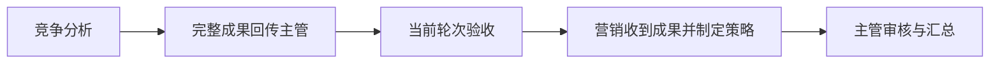
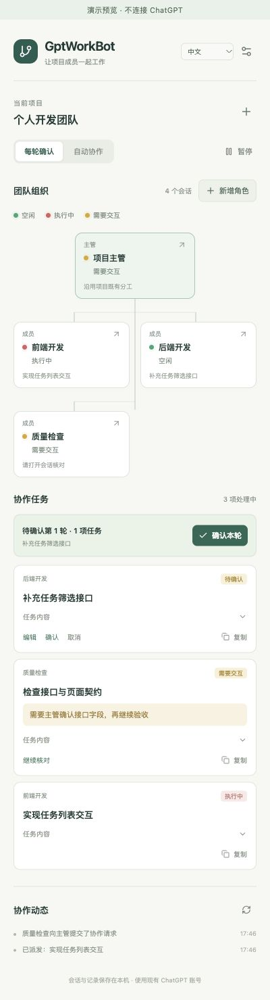

# GptWorkBot

**把 ChatGPT 项目里的 Work 会话，组织成职责清楚、依赖可见、逐轮可审核的协作团队。**

面向个人开发者的 Chrome 侧栏插件。在主管会话里下达目标，在侧栏查看团队、审核计划与成果，让不同角色按任务依赖接续工作。已有项目上下文与职责继续沿用，无需另外配置 API Key 或独立协作后台。

**1.0.0 · Chrome 120+ · 简体中文 / English · 使用已有 ChatGPT 登录 · 版本测试阶段**

[English](README.en.md) · [下载安装包](https://github.com/dickenson258/GptWorkBot/releases/tag/v1.0.0) · [开始使用](#开始使用) · [详细文档](docs/README.md)

## 三件事，把协作看清楚

- **任务依赖**：主管一次规划整条任务链。无依赖任务可并行；有依赖任务等待前置成果回传并通过当前轮次验收，再自动收到完整成果。
- **角色分工**：绑定已有会话，或在当前项目新增 Work 角色。角色名称、职责、可选首个任务与验收条件一起配置。
- **逐轮审核**：默认确认整轮计划再派发。草稿可编辑任务与前置关系；批准后依赖固定。主管可指导原任务修订，保留成果历史。

组织图用 **绿点表示空闲、红点表示执行中、黄点表示需要交互**；灰色表示未连接或状态过期。等待正常前置的角色保持空闲，侧栏说明等待完成、回传或验收的原因。

## 从一条依赖链开始

在主管会话下达目标：

> 分析当前产品的竞争力，对比竞品优劣势，再让营销基于已验收分析制定宣传策略。请预先规划整条任务链。



确认本轮计划后，营销继续等待分析结果和验收。前置成果需修订时，主管指导原任务继续，后续保持等待；新版成果回传并验收后才接续。

## 功能预览

<table>
  <tr><th>团队与任务</th><th>角色与验收条件</th><th>前置等待与输入</th></tr>
  <tr>
    <td valign="top"></td>
    <td valign="top"></td>
    <td valign="top"></td>
  </tr>
</table>

*截图来自 0.1.8／0.2.0 的本地样例预览，保留“不连接 ChatGPT”标识；顶部为品牌概念插画。截图用于展示界面，不作为已安装扩展完整协作闭环的证据。*

## 开始使用

账号需能够访问所用的 ChatGPT 项目、Work 与工具。插件目前通过 Chrome 开发者模式加载，尚未上架扩展商店。

1. 从 [1.0.0 Release](https://github.com/dickenson258/GptWorkBot/releases/tag/v1.0.0) 下载 `gptworkbot-1.0.0.zip` 并解压。
2. 打开 `chrome://extensions`，开启“开发者模式”，选择“加载已解压的扩展程序”，选中包含 `manifest.json` 的目录。
3. 刷新 ChatGPT，打开 GptWorkBot 侧栏，进入已有项目或其中一个 Work 会话。
4. “绑定会话”→“读取当前项目”，选取主管与成员，确认 Work 模式，连接项目并批量加入；也可通过“新增角色”创建当前项目的角色。
5. 点击“连接协作 · 同步消息路由”，待角色就绪后向主管下达目标，在侧栏审核整轮计划及成果。

首次建议使用“每轮确认”和一条两角色依赖链。自动模式支持轮数上限；原生权限、登录、额度与进一步交互仍在原会话处理。

### 从源码构建

需要 Node.js 20.13+。

```sh
git clone https://github.com/dickenson258/GptWorkBot.git
cd GptWorkBot
npm ci
npm test
npm run package
npm run verify-package
```

构建后加载 `dist/`。开发预览、角色创建、恢复及完整命令见 [开发与使用说明](docs/development.md)。

### 升级到 1.0.0

在同一扩展目录更新已有 0.2.x 安装，重新加载扩展、刷新 ChatGPT 并重开侧栏，v2 团队与任务保留。“重新核对会话”可恢复因原生文件引用引号导致解析失败的已送达回报。从 v1 安装升级时，重新读取项目、绑定团队并连接新版协议。协议继续为 v2，存储键为 `gptworkbot-state-v2`。

## 运行与数据

- **使用已有账号权限与额度**。无需另配模型 API Key，不表示 ChatGPT 的使用免费。
- **插件记录保存在本地**。任务与成果作为普通消息进入绑定的 ChatGPT 会话历史，没有独立的协作上传服务。
- **当前一次管理一组项目团队**。成员协作由主管协调；完整 `summary` 作为下游输入，第一版不传输外部文件或提取任意产物字段。
- **关闭浏览器会停止插件调度**。暂停与解绑控制后续插件消息，已启动的原生 Work 任务需在 ChatGPT 内核对。
- **执行依赖 Work 的上下文、工具和权限**。插件提供派发与审核流程，成果正确性仍需验收。

GptWorkBot 是独立项目，非 OpenAI 官方扩展。

## 验证与文档

1.0.0 基于已有 v2 实现发布。273 项自动化测试、类型检查、构建与安装包校验通过；原生页面及现场 DOM 重放的范围单独记录。已安装扩展的完整“分析 → 回传 → 验收 → 营销 → 汇总”及异常流程仍保留为人工验收项。

- [产品介绍](docs/product-introduction.md) · [插件需求](docs/requirements.md)
- [架构与协议 v2](docs/architecture.md) · [开发与使用](docs/development.md)
- [验证记录](docs/verification.md) · [首页审核与发布记录](PUBLISHING.md)
- [文档和首页归档](docs/archive/README.md)

## 反馈

通过 [Issues](https://github.com/dickenson258/GptWorkBot/issues) 分享你的具体协作流程，或提交浏览器版本、插件版本和复现步骤。请移除私人会话内容、账号信息与敏感材料。
