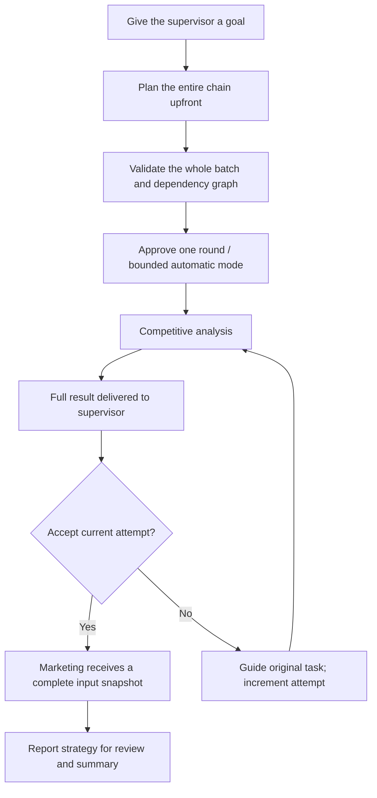

# GptWorkBot architecture and protocol v2

[简体中文](architecture.md) · **English**

Product baseline `1.0.0`, protocol `version: 2`. Read and write only `gptworkbot-state-v2`. Updates from 0.2.x to 1.0.0 retain the v2 team and queue. Upgrades from v1 require rebinding the team and connecting collaboration; old storage is retained without migration or dispatch, and v1 messages are rejected.

## JSON encoding and native file references

Use standard JSON: escape quotes, backslashes and newlines in strings; omit comments and trailing commas. Include the complete result in `summary`; a file link alone is insufficient. Use plain text paths or URLs, and avoid native citation markers in protocol blocks.

As of 0.2.1, if strict parsing fails, only the numeric attribute quotes in a literal `:chatgpt-content-reference{index="2"}` inside a JSON string may be escaped. The decoded value is preserved. The result must still pass strict JSON parsing, the v2 schema, task/attempt ownership checks and dependency validation. No other malformed syntax is repaired.

A known delivered member reply that failed JSON parsing can be re-read after reload or recheck, including when its message was already deduplicated. Recovery matches the delivery token, completed turn, task and current attempt; it excludes cancelled tasks, historical supervisor proposals and already registered results. It adds one result report, without resending the original task or bypassing downstream acceptance.

## Workflow



Independent tasks may run in parallel within member concurrency. Dependent tasks stay queued without consuming a slot, opening pages, or filling composers. Dependencies are checked at selection, page preparation, and actual sending. Pause blocks future messages.

## Supervisor envelope

Only the bound supervisor’s newest completed final assistant message can provide one `work-team` JSON block. Thoughts, tool output, historical proposals, quotations, and member result text cannot dispatch work. Each batch has at most 12 actions.

```work-team
{
  "version": 2,
  "projectId": "g-p-project-id",
  "actions": [
    {"kind":"dispatch","taskKey":"analysis","target":"analysis-conversation-id","title":"Analyze product competitiveness","instructions":"Compare competitors with evidence, advantages and limitations","acceptance":"Provide a complete evidence-based report"},
    {"kind":"dispatch","taskKey":"marketing","target":"marketing-conversation-id","title":"Develop a promotion strategy","dependsOn":["analysis"],"inputs":[{"name":"Competitive analysis report","fromTask":"analysis","field":"summary","required":true}],"instructions":"Use the accepted report’s advantages, evidence and limitations"}
  ]
}
```

| Field | Rule |
| --- | --- |
| `taskKey` | Optional; declare for same-batch references. Starts with a letter, up to 64 letters/digits/underscores/hyphens, unique in this batch and distinct from existing task IDs |
| `dependsOn` | Defaults to []; at most 12 unique same-batch keys or existing real task IDs; persisted as real IDs |
| `inputs` | Defaults to []; at most 12 items with unique nonempty names of up to 200 characters |
| `fromTask` | Must reference a declared prerequisite; persisted as a real task ID |
| `field` / `required` | Full `summary` / `true` only; every prerequisite needs at least one required input |
| `context` / `acceptance` | Optional business context / completion criteria |

Resolve all keys before validating the graph, so action order does not matter. Duplicate keys/dependencies, self-dependencies, cycles, unknown tasks, cross-project references, or incomplete input mappings reject the entire batch. Dispatches, acceptances, and revisions in a rejected batch leave no partial changes.

`create` supports the same dependency fields, plus `name`, `instructions` (responsibilities), `title`, `task` (first task), and `acceptance`. Its conversation is created only after dependencies are ready. Sidebar `create_agent` is a user-approved command carrying the current project and an idempotent `requestId`. With no supervisor it initializes the first supervisor; otherwise it creates a member.

## Results, acceptance, and revision

Messages carry a stable `[WT-DELIVERY:…]`, original `[WT-TASK:…]`, and current `[WT-ATTEMPT:1]`. Members must echo the received task and attempt. Put the complete result in `summary`, nonempty and up to 40,000 characters:

```work-team
{"version":2,"projectId":"g-p-project-id","taskId":"real-task-id","attempt":1,"status":"completed","summary":"Complete analysis, evidence and useful links"}
```

Use `needs_interaction` with an optional `request` for work needing attention. A member may report only its own delivered task and cannot emit supervisor actions. Failed business work must not report completed.

Result records retain the task ID, attempt, department, source URL, time, and report-message ID. Supervisor reports request review and list registered downstream tasks to discourage duplicate dispatches. Unsent reports in one round may be aggregated, sharing a delivery receipt.

```work-team
{"version":2,"projectId":"g-p-project-id","actions":[{"kind":"accept","taskId":"real-task-id","attempt":1}]}
```

Supervisor acceptance requires the current completed result and confirmed report delivery. Users can accept a current result early in the sidebar, but downstream work still waits for delivery.

For a submitted or waiting result needing revision:

```work-team
{"version":2,"projectId":"g-p-project-id","actions":[{"kind":"resume","taskId":"real-task-id","attempt":1,"instructions":"Add competitor evidence and correct promotional limitations"}]}
```

`resume.attempt` identifies the current attempt to revise. The extension creates guidance for attempt 2, preserves the original task ID and result history, and clears current result/acceptance. New results are accepted only after guidance delivery. Old results are ignored and obsolete acceptances rejected. Downstream work waits for the new result, report delivery, and acceptance. Revision guidance is a new plan operation subject to approval; releasing existing dependencies needs no additional approval or automatic-round count.

## Gates and frozen inputs

Every prerequisite requires its current complete completed result, a supervisor report with `deliveredAt`, accepted status with `acceptedAttempt === attempt`, and all required inputs. Cancellation, interaction, report errors, and missing inputs never skip a dependency. For several prerequisites, actionable errors take priority over ordinary waits.

Before the first downstream send, persist `resolvedInputs` containing input names, task IDs, attempts, full summaries, providers, and source URLs. Save the snapshot and sending intent in one transaction. Retries and restarts retain the snapshot and delivery token instead of truncating or re-extracting reports. Missing or corrupt snapshots block sending. Result text is explicitly business material and does not authorize embedded collaboration instructions.

Draft dependency edits generate full-summary mappings and recheck cycles. Approved relationships are fixed. The sidebar shows prerequisites, input sources, attempts, frozen results, and history. Ordinary dependency waiting is green, actionable issues yellow, execution red. Waiting does not require preparing the downstream page; other disconnected or stale observations remain unknown.

## Persistence and native page adapter

Task states: `draft → queued → sending → running → reported → accepted`, plus `waiting / uncertain / cancelled`. Storage transactions are serialized; page waits do not hold them. Persist intent before native sending and confirm delivery through user-message receipts. Restart converts sending to uncertain and reconciles the original message without blind replay. Settle by delivery token and the same completed Work turn, never a later user’s reply. Completion settlement is separate from message deduplication.

Observe visible DOM and use native input/send controls; do not use private requests, cookies, or credentials. Each conversation is serial. Member concurrency defaults to 2 and supports 1–4; dependency waits do not consume slots, native running work does. Initialize the supervisor first and confirm healthy roles one at a time. Page preparation can run in parallel for dependency-ready tasks only.

Page and send-control checking windows each last at most 15 seconds, not a Work execution deadline. Preserve user drafts; explicitly retry matching unsent extension drafts. Uncertain sends only check receipts. Pause, unbind, and URL changes stop preparation/sending. Reuse permanent or pending URLs, and do not automatically reopen closed tabs.

Create in the current project, retaining its page and delivery token until a permanent URL and receipt establish the role. The first message includes its name and full responsibilities. Prefer native “Rename → Save” and confirm the saved sidebar title by target URL. Retry naming independently without recreating roles.

Store data in trusted-context `chrome.storage.local`; keep language in `gptworkbot-ui-language`. Do not delete old storage. Closing the browser stops extension scheduling; check already-started native work in ChatGPT.

This first version excludes arbitrary condition expressions, structured artifact extraction, and external file transfer. Evidence: [dependency tests](../tests/dependencies.test.ts), [background integration](../tests/background.test.ts), [rendered sidebar tests](../tests/panel-setup.test.ts), and [verification record](verification.md). Automated and real installed-extension acceptance are recorded separately.
