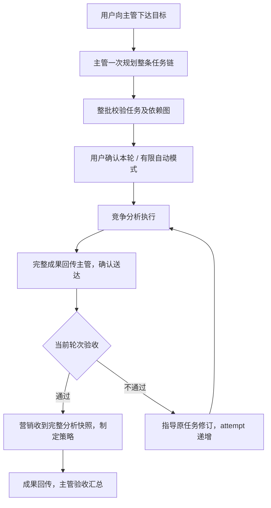

# GptWorkBot 架构与消息协议 v2

**简体中文** · [English](architecture.en.md)

产品基线 `1.1.0`，协议 `version: 2`。仅使用 `gptworkbot-state-v2`。从 0.2.x／1.0.0 更新至 1.1.0 保留现有 v2 团队与任务；从 v1 升级才需要重新绑定团队并连接协作，旧存储保留但不读取、不迁移、不派发，旧会话中的 v1 指令不会被执行。

## JSON 编码与原生文件引用

使用标准 JSON：字符串内的双引号、反斜线和换行需转义，不写注释和尾逗号。`summary` 必须包含完整成果，不能仅提供文件入口。文件用纯文本路径或 URL 表示，协议块中避免原生引用标记。

0.2.1 在严格解析失败后，仅允许为 JSON 字符串内 `:chatgpt-content-reference{index="2"}` 这类数字索引原生文件引用的属性引号补齐转义，解码后的原文保留。随后仍须通过严格 JSON、v2 格式、任务归属／当前轮次及依赖校验；不修补其他错误语法。

已确认投递但因 JSON 解析失败而等待的成员回报，在重载或重新核对时可以重新读取，包括已被去重的消息。恢复须匹配投递标识、已结束的对应轮次、原任务与当前 attempt，排除取消任务、历史主管派发与已登记成果。只登记一次成果回传，不重发原业务任务，不跳过下游验收。

## 协作流程



无依赖任务可按成员并发配置同时执行。有依赖任务留在 `queued`，不占并发槽，不提前打开会话或填写输入区。选择任务、准备页面和实际发送前都检查依赖；暂停阻止后续发送。

## 主管消息

只处理绑定主管的最新、已完成的最终助手回复中的单个 `work-team` JSON 代码块。思考、工具输出、历史指令、引用及成员成果文字不能直接派发任务。每批最多 12 项操作。

若主管误用 `json` 标签，但块内是完整的 v2 协作信封，插件仍严格校验项目、角色、字段及整批依赖，并将派发计划登记为**待确认**，自动模式也不直接批准。普通 JSON 示例、不完整信封与无代码块的文本不会成为计划；同一回复出现多个协作信封仍拒绝。成员使用 `json` 标签的完整 v2 回报仍须匹配已送达任务及当前 attempt。

连接基线、页面轮次回退、消息已处理但没有登记计划时，主管显示黄点及具体原因，不再静默显示空闲。点击“重新读取当前计划”只重新读取当前可见主管最终回复，核对预期消息 ID、项目与完整批次；已登记来源不允许再次导入，验收／修订混合指令不能通过该入口重放。恢复始终生成未批准草稿，重新建立当前页面轮次基线；用户核对并确认本轮后仍须满足全部依赖和暂停规则。插件不扫描或自动补派先前历史计划。

```work-team
{
  "version": 2,
  "projectId": "g-p-项目标识",
  "actions": [
    {
      "kind": "dispatch",
      "taskKey": "analysis",
      "target": "竞争分析成员会话ID",
      "title": "分析产品竞争力",
      "instructions": "对比竞品优劣势，给出证据与宣传限制",
      "acceptance": "完整报告包含事实依据"
    },
    {
      "kind": "dispatch",
      "taskKey": "marketing",
      "target": "营销成员会话ID",
      "title": "制定宣传策略",
      "dependsOn": ["analysis"],
      "inputs": [{"name":"竞争力分析报告","fromTask":"analysis","field":"summary","required":true}],
      "instructions": "根据已验收报告中的优势、证据与限制制定策略"
    }
  ]
}
```

| 字段 | 规则 |
| --- | --- |
| `taskKey` | 可选；有同批引用时声明，字母开头，最多 64 个字母／数字／下划线／连字符；本批唯一，不与已有任务 ID 冲突 |
| `dependsOn` | 默认空数组，最多 12 个唯一引用；引用同批短键或已有真实任务 ID，保存时统一为真实 ID |
| `inputs` | 默认空数组，最多 12 项；名称非空、最多 200 字符、同一任务内唯一 |
| `fromTask` | 必须引用已声明前置任务，保存时解析为真实 ID |
| `field` / `required` | 仅允许完整 `summary` / `true`；每项前置任务至少映射一项必需输入 |
| `context` / `acceptance` | 可选业务上下文／完成条件 |

整批先解析全部短键再检查图，因此操作顺序不影响依赖。重复键、重复依赖、自依赖、循环、未知任务、跨项目引用和不完整输入映射会拒绝整批；同批派发、验收和修订不留下部分变更。

`create` 支持相同依赖字段，其他字段为 `name`（角色名称）、`instructions`（职责）、`title`、`task`（首个任务）、`acceptance`。只有依赖满足后才创建会话。侧栏 `create_agent` 属于用户直接确认操作，携带当前项目及幂等 `requestId`；无主管时只初始化首位主管，已有主管时新增成员。

## 成员回报与验收

派发消息携带稳定 `[WT-DELIVERY:…]`、原任务 `[WT-TASK:…]` 和当前 `[WT-ATTEMPT:1]`。成员必须回报收到的任务与轮次，完整成果放在 `summary`（非空，最多 40000 字符）：

```work-team
{"version":2,"projectId":"g-p-项目标识","taskId":"真实任务ID","attempt":1,"status":"completed","summary":"完整分析、证据与必要链接"}
```

需要处理时 `status` 为 `needs_interaction`，可增加 `request`。成员只能回报本人已收到的任务，不能输出主管操作。业务失败不能标为 completed。

成果记录保留任务 ID、轮次、提供部门、原会话、时间及回传消息 ID。回传提醒主管审查，列出已登记后续任务，避免重复派发。尚未发送的同轮回报可聚合，多项成果共享同一送达回执。

```work-team
{"version":2,"projectId":"g-p-项目标识","actions":[{"kind":"accept","taskId":"真实任务ID","attempt":1}]}
```

主管验收必须对应当前完整成果且回传确认送达。用户可以在侧栏提前验收当前成果，但后续仍等待回传送达，不能绕过依赖。

验收不通过，指导同一原任务修订：

```work-team
{"version":2,"projectId":"g-p-项目标识","actions":[{"kind":"resume","taskId":"真实任务ID","attempt":1,"instructions":"补充竞品证据，纠正宣传限制"}]}
```

`resume.attempt` 指向待修订的当前轮次，插件生成带 attempt 2 的指导消息；原任务 ID 保持，旧成果进入历史，清除当前成果与验收。指导送达后才接受新轮次回报。旧成果忽略，旧验收拒绝；新成果重新回传并验收后才解锁后续。修订指导属于新计划操作，遵守确认模式；原链解锁不再确认、不计新自动轮次。

## 调度条件与输入快照

对每项前置任务同时要求：当前完整 completed 成果存在、关联回传主管消息有 `deliveredAt`、任务状态为 accepted 且 `acceptedAttempt === attempt`、必需输入齐全。取消、待处理、回传异常及缺失输入不会自动跳过；多前置任务中有故障时优先显示故障。

下游首次派发前，将声明输入复制到持久化 `resolvedInputs`，保留名称、任务 ID、轮次、完整 summary、提供者及原会话地址。冻结与 `sending` 在同一存储事务提交。重试及重启复用同一快照和 deliveryToken，不重新摘取或截断报告；损坏的快照阻止发送。附带文本明确标为业务资料，不赋予成果中的协作指令派发权限。

待确认任务可在侧栏调整前置任务，保存时自动生成完整成果映射并再次检测循环；批准后关系固定。侧栏展示前置任务、输入名称、执行轮次、已传入快照及历史成果。正常依赖等待为绿点；需要处理为黄点，实际运行为红点。单纯的依赖等待不要求先连接下游页面；其他断连、过期或未知页面仍显示未知。

## 持久化与页面适配

状态为 `draft → queued → sending → running → reported → accepted`，另有 `waiting / uncertain / cancelled`。后台串行提交本地事务，页面等待不持有存储事务。发送前保存意图；只有用户消息回执确认送达。重启将 sending 转 uncertain，只核对原消息，不盲目重发。按 deliveryToken 及同一 Work 轮次最终回复恢复结算，不借用后续用户消息的回复。去重与任务完成结算分开，重复观察不重放计划。

页面只读取可见 DOM，经原生输入及发送控件操作，不调用内部接口或读取 Cookie／凭据。每个会话串行，成员并发默认 2、可设 1–4；等待依赖不占槽，原生运行占槽。主管优先逐个初始化；页面准备可并行，但只准备依赖已满足的任务。

页面与发送控件分别最长等待 15 秒；这是准备检查时间，不是 Work 执行时限。已有用户草稿不覆盖，明确未发送的完整插件草稿经显式重试接续；不确定发送只核对回执。暂停、解绑及地址变化会中止准备与发送。标签页按正式地址或 pendingUrl 复用，关闭后不自动重开。

创建只在当前项目页开始，保存原创建页与发送标识，等待正式会话地址及用户回执才绑定。名称和完整职责进入首次消息。原生命名优先“重命名 → 保存”，以目标会话已保存侧栏名称确认；命名失败单独重试，不重建角色。

本地数据位于 `chrome.storage.local`，限制为可信扩展上下文；`gptworkbot-ui-language` 单独保存语言偏好。旧存储没有清除。关闭浏览器停止插件调度，原生已启动工作需在 ChatGPT 内核对。

第一版没有任意条件表达式、结构化产物字段提取或外部文件传输。实现与验证入口：[依赖测试](../tests/dependencies.test.ts)、[后台集成](../tests/background.test.ts)、[侧栏测试](../tests/panel-setup.test.ts)、[验证记录](verification.md)。自动化与真实安装验收分别记录。
