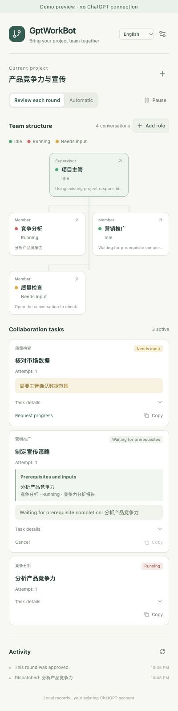

# 验证记录 · 2026-10-10

## 0.2.0 任务依赖、完整成果与修订轮次

- **自动化验证**：`npm test` 共 13 个文件、245 项通过；严格类型检查和 `npm run package` 通过。版本与安装包均为 0.2.0，ZIP 完整性、内容与 dist 一致性另行校验。旧存储读取／迁移逻辑移除，测试确认只访问 `gptworkbot-state-v2`，旧键不被写入或删除。
- 协议 v2 增加 taskKey、dependsOn、必需完整 summary 输入，以及成员回报／验收／指导的 attempt。整批解析键到真实 ID，拒绝重复键、循环、自依赖、未知任务、跨项目和不完整映射；错误批次不留下派发、验收或修订的部分变更。
- 核心回归覆盖分析到营销的完整顺序、多前置汇合、无依赖并行、一次批准后营销不能提前启动、用户提前验收但回传尚未送达、修订历史和旧轮次失效、交互／取消／缺失输入、暂停、重启、聚合回执与重复观察。
- Chrome API **模拟后台集成**确认营销等待期间不打开新页或预填任务，回传主管并验收后才打开；下游收到完整分析、来源地址与当前轮次。重试使用已持久化快照和相同发送标识；重启核对已送达成果，不重发。依赖创建也等待后再建会话，首次职责与输入齐全。
- 手动重试的页面准备同样先检查依赖；同一会话的独立任务页面失败，不把等待依赖的其他任务改成失败。发送准备期间原任务完成时取消过期指导，避免迟到消息影响成果。
- **侧栏自动化与本地浏览器预览**：实际挂载 React 验证中英文等待原因、绿色正常等待、黄色前置取消、复制禁用、草稿依赖编辑／输入映射、批准后禁止编辑及修订历史。400px 浏览器预览两种语言 viewport 与文档宽度都为 400，无横向溢出；展示前置任务、提供部门与输入名称。两张公开截图使用样例数据，无真实会话。
- 更新双语产品介绍、需求文档（FR-14）及协议文档，文档版本 2.0；保留 0.1.8 固定归档，并建立 0.2.0 文档快照。
- **真实会话验收**：本轮没有重载已安装扩展，也未向用户 ChatGPT 会话发送任务。完整“分析 → 回传 → 验收 → 营销 → 主管汇总”和修订／重启的真实安装联调仍待验收；自动化及演示预览不作为真实闭环证据。更新后需重新绑定团队并连接新版协议，旧存储保留但不派发。

