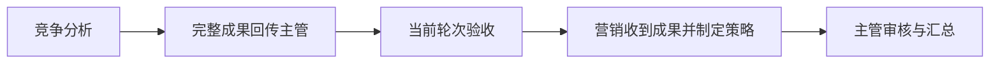
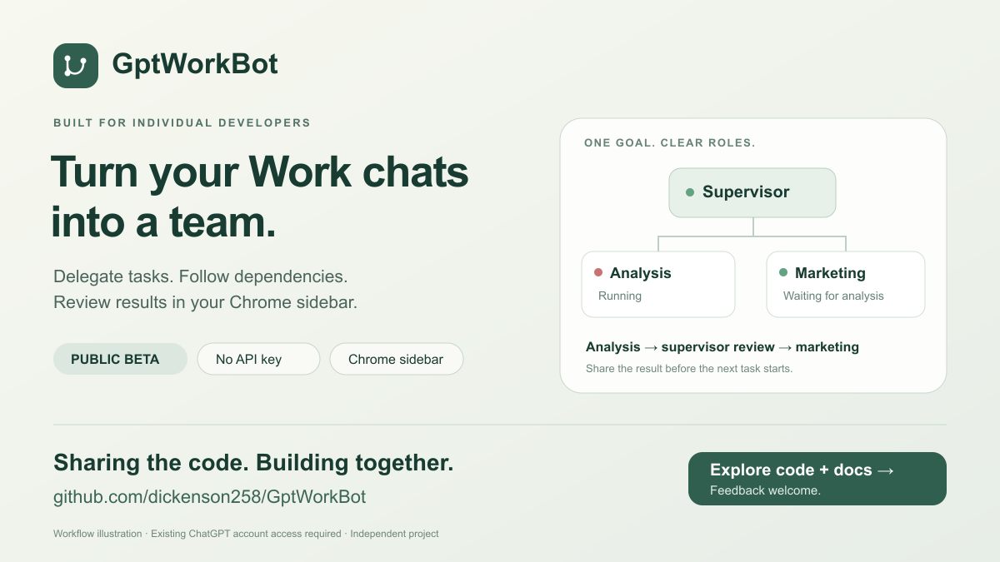
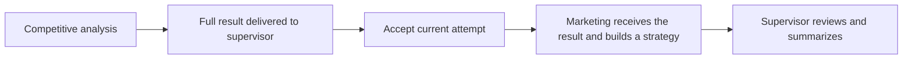
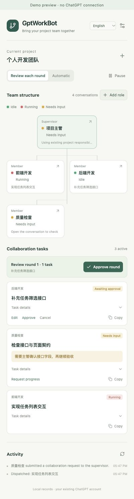
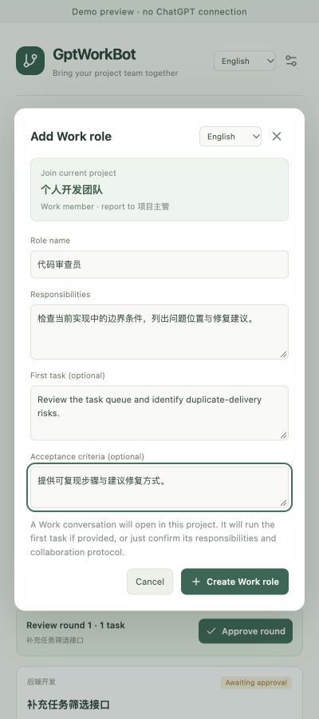

# GptWorkBot

**把 ChatGPT 项目里的 Work 会话，组织成职责清楚、依赖可见、逐轮可审核的协作团队。**

面向个人开发者的 Chrome 侧栏插件。在主管会话里下达目标，在侧栏查看团队、审核计划与成果，让不同角色按任务依赖接续工作。已有项目上下文与职责继续沿用，无需另外配置 API Key 或独立协作后台。

**1.2.0 · Chrome 120+ · 简体中文 / English · 使用已有 ChatGPT 登录 · 版本测试阶段**

[English](#english) · [下载安装包](https://github.com/dickenson258/GptWorkBot/releases/tag/v1.2.0) · [开始使用](#开始使用) · [详细文档](https://github.com/dickenson258/GptWorkBot/blob/main/docs/README.md)

<details>
<summary>English 页面加载失败？</summary>

English 入口直接跳转到本页英文区段。若独立英文文档的 GitHub 文件预览显示 “Error loading page”，可返回本页继续阅读，或下载 [离线中英文首页归档](https://github.com/dickenson258/GptWorkBot/releases/download/v1.2.0/gptworkbot-homepage-v1.2.0-2026-10-12.zip)。

</details>

## 三件事，把协作看清楚

- **任务依赖**：主管一次规划整条任务链。无依赖任务可并行；有依赖任务等待前置成果回传并通过当前轮次验收，再自动收到完整成果。
- **角色分工**：绑定已有会话，或在当前项目新增 Work 角色。角色名称、职责、可选首个任务与验收条件一起配置。
- **逐轮审核**：默认确认整轮计划再派发。草稿可编辑任务与前置关系；批准后依赖固定。主管可指导原任务修订，保留成果历史。

组织图用 **绿点表示空闲、红点表示执行中、黄点表示需要交互**；灰色表示未连接或状态过期。等待正常前置的角色保持空闲，侧栏说明等待完成、回传或验收的原因。

## 从一条依赖链开始

在主管会话下达目标：

> 分析当前产品的竞争力，对比竞品优劣势，再让营销基于已验收分析制定宣传策略。请预先规划整条任务链。



确认本轮计划后，营销继续等待分析结果和验收。前置成果需修订时，主管指导原任务继续，后续保持等待；新版成果回传并验收后才接续。

## 功能预览

<table>
  <tr><th>团队与任务</th><th>角色与验收条件</th><th>前置等待与输入</th></tr>
  <tr>
    <td valign="top"></td>
    <td valign="top"></td>
    <td valign="top"></td>
  </tr>
</table>

*截图来自 0.1.8／0.2.0 的本地样例预览，保留“不连接 ChatGPT”标识；顶部为品牌概念插画。截图用于展示界面，不作为已安装扩展完整协作闭环的证据。*

## 开始使用

账号需能够访问所用的 ChatGPT 项目、Work 与工具。插件目前通过 Chrome 开发者模式加载，尚未上架扩展商店。

1. 从 [1.2.0 Release](https://github.com/dickenson258/GptWorkBot/releases/tag/v1.2.0) 下载 `gptworkbot-1.2.0.zip` 并解压。
2. 打开 `chrome://extensions`，开启“开发者模式”，选择“加载已解压的扩展程序”，选中包含 `manifest.json` 的目录。
3. 刷新 ChatGPT，打开 GptWorkBot 侧栏，进入已有项目或其中一个 Work 会话。
4. “绑定会话”→“读取当前项目”，选取主管与成员，确认 Work 模式，连接项目并批量加入；也可通过“新增角色”创建当前项目的角色。
5. 点击“连接协作 · 同步消息路由”，待角色就绪后向主管下达目标，在侧栏审核整轮计划及成果。

首次建议使用“每轮确认”和一条两角色依赖链。自动模式支持轮数上限；原生权限、登录、额度与进一步交互仍在原会话处理。

### 从源码构建

需要 Node.js 20.13+。

```sh
git clone https://github.com/dickenson258/GptWorkBot.git
cd GptWorkBot
npm ci
npm test
npm run package
npm run verify-package
```

构建后加载 `dist/`。开发预览、角色创建、恢复及完整命令见 [开发与使用说明](https://github.com/dickenson258/GptWorkBot/blob/main/docs/development.md)。

### 升级到 1.2.0

在同一扩展目录更新已有 0.2.x／1.0.0／1.1.0 安装，重新加载扩展、刷新 ChatGPT 并重开侧栏，v2 团队与任务保留。“重新核对会话”可恢复因原生文件引用引号导致解析失败的已送达回报。从 v1 安装升级时，重新读取项目、绑定团队并连接新版协议。协议继续为 v2，存储键为 `gptworkbot-state-v2`。

### 1.2.0 更新

- **结构提示跟随界面语言**：连接说明、角色初始化、任务标签、输入成果、成员回传及修订提示支持中英文；角色名称、用户任务及成果保留原文。
- **可靠的就绪确认**：兼容缺少 Work 最终回复外层标记的原生答复，修复已返回“协作已就绪”却一直等待的问题。升级后重新核对即可读取已有确认，无需重发初始化。
- **主管与队列对齐**：连接说明包含当前项目任务登记快照，英文 Analysis／Marketing 示例按角色匹配，减少把历史计划误当作已派发的情况。
- **发送重试保持一致**：首次发送前保存完整消息和语言，重试沿用相同内容、输入快照与发送标识。

保留 1.1.0 的当前计划诊断与“重新读取当前计划”入口；恢复仅生成待确认草稿，依赖与暂停规则继续生效，不自动补派历史计划。

## 运行与数据

- **使用已有账号权限与额度**。无需另配模型 API Key，不表示 ChatGPT 的使用免费。
- **插件记录保存在本地**。任务与成果作为普通消息进入绑定的 ChatGPT 会话历史，没有独立的协作上传服务。
- **当前一次管理一组项目团队**。成员协作由主管协调；完整 `summary` 作为下游输入，第一版不传输外部文件或提取任意产物字段。
- **关闭浏览器会停止插件调度**。暂停与解绑控制后续插件消息，已启动的原生 Work 任务需在 ChatGPT 内核对。
- **执行依赖 Work 的上下文、工具和权限**。插件提供派发与审核流程，成果正确性仍需验收。

GptWorkBot 是独立项目，非 OpenAI 官方扩展。

## 验证与文档

当前 1.2.0 源码共 334 项自动化测试通过，类型检查、构建与安装包校验通过；原生页面及现场 DOM 重放的范围单独记录。已安装扩展的完整“分析 → 回传 → 验收 → 营销 → 汇总”及异常流程仍保留为人工验收项。

- [产品介绍](https://github.com/dickenson258/GptWorkBot/blob/main/docs/product-introduction.md) · [插件需求](https://github.com/dickenson258/GptWorkBot/blob/main/docs/requirements.md)
- [架构与协议 v2](https://github.com/dickenson258/GptWorkBot/blob/main/docs/architecture.md) · [开发与使用](https://github.com/dickenson258/GptWorkBot/blob/main/docs/development.md)
- [验证记录](https://github.com/dickenson258/GptWorkBot/blob/main/docs/verification.md) · [首页审核与发布记录](https://github.com/dickenson258/GptWorkBot/blob/main/PUBLISHING.md)
- [文档和首页归档](https://github.com/dickenson258/GptWorkBot/blob/main/docs/archive/README.md)

## 反馈

通过 [Issues](https://github.com/dickenson258/GptWorkBot/issues) 分享你的具体协作流程，或提交浏览器版本、插件版本和复现步骤。请移除私人会话内容、账号信息与敏感材料。

<!-- BEGIN ENGLISH HOMEPAGE -->

## English



**Organize your ChatGPT project's Work chats into a team with clear roles, visible dependencies and review at each round.**

A Chrome side-panel extension for individual developers. Give the supervisor chat a goal, review the plan and results in the sidebar, and let roles continue in dependency order. Keep existing project context and responsibilities. No additional API key or separate coordination backend is required.

**1.2.0 · Chrome 120+ · Chinese / English · Existing ChatGPT login · Testing release**

[简体中文](#gptworkbot) · [Download](https://github.com/dickenson258/GptWorkBot/releases/tag/v1.2.0) · [Getting started](#getting-started) · [Documentation](https://github.com/dickenson258/GptWorkBot/blob/main/docs/README.en.md)

<details>
<summary>Page failed to load?</summary>

If GitHub's file preview shows “Error loading page”, read the [English section on this page](#english) or download the [offline bilingual homepage archive](https://github.com/dickenson258/GptWorkBot/releases/download/v1.2.0/gptworkbot-homepage-v1.2.0-2026-10-12.zip).

</details>

## Make collaboration easier to follow

- **Task dependencies:** the supervisor plans the full chain upfront. Independent work may run in parallel. Dependent tasks wait for a complete prerequisite result to reach the supervisor and pass acceptance of the current attempt, then receive that result automatically.
- **Role responsibilities:** bind existing chats or create Work roles in the current project. Configure a name, responsibilities, an optional first task and acceptance criteria.
- **Review each round:** approve the plan before dispatch by default. Edit tasks and prerequisites while they are drafts; approved dependencies stay fixed. The supervisor can request revisions of the original task while preserving result history.

The team chart uses **green for idle, red for running and yellow for interaction needed**. Gray means disconnected or stale. A role waiting on normal prerequisites stays idle; the sidebar explains whether it is waiting for completion, report delivery or acceptance.

## Start with one dependency chain

Give the supervisor a goal:

> Analyze product competitiveness and competitor strengths and weaknesses, then have marketing build a strategy from the accepted analysis. Plan the full chain upfront.



Approving the round does not start marketing early. If analysis needs revision, the supervisor guides the original task and downstream work keeps waiting. The revised result must reach the supervisor and pass acceptance before the next task starts.

## Interface previews

<table>
  <tr><th>Team and tasks</th><th>Roles and acceptance criteria</th><th>Prerequisites and inputs</th></tr>
  <tr>
    <td valign="top"></td>
    <td valign="top"></td>
    <td valign="top"></td>
  </tr>
</table>

*These local sample previews were captured in 0.1.8/0.2.0 and retain the “no ChatGPT connection” label. The hero is a conceptual brand illustration. Previews are not evidence of a complete installed-extension workflow. Names and business content keep their original language.*

## Getting started

Your account must have access to the ChatGPT project, Work and tools you use. The extension currently loads through Chrome's developer mode and is not listed in the Chrome Web Store.

1. Download `gptworkbot-1.2.0.zip` from the [1.2.0 Release](https://github.com/dickenson258/GptWorkBot/releases/tag/v1.2.0) and extract it.
2. Open `chrome://extensions`, enable Developer mode and choose **Load unpacked**. Select the folder containing `manifest.json`.
3. Refresh ChatGPT, open the GptWorkBot sidebar and enter an existing project or one of its Work chats.
4. Choose **Bind conversations → Read current project**. Select a supervisor and members, confirm Work mode, connect the project and import the team. Alternatively, use **Add role** to create roles in that project.
5. Choose **Connect collaboration · sync routes**. When roles are ready, give the supervisor a goal and review the plan and results in the sidebar.

For the first run, use **Review each round** and a small two-role chain. Automatic mode has a round limit; handle native permissions, login, usage limits and further interaction in the original chat.

### Build from source

Requires Node.js 20.13+.

```sh
git clone https://github.com/dickenson258/GptWorkBot.git
cd GptWorkBot
npm ci
npm test
npm run package
npm run verify-package
```

Load `dist/` after building. See [development and operations](https://github.com/dickenson258/GptWorkBot/blob/main/docs/development.en.md) for preview commands, role creation and recovery.

### Upgrade to 1.2.0

Update an existing 0.2.x / 1.0.0 / 1.1.0 installation in the same extension directory, reload the extension, refresh ChatGPT and reopen the sidebar. The v2 team and tasks are retained. **Recheck conversations** can recover delivered results whose JSON failed because of native file-reference quotes. From a v1 installation, rebind the team and connect the new protocol. The protocol remains v2 and storage remains `gptworkbot-state-v2`.

### What changed in 1.2.0

- **Prompts follow the interface language:** connection guidance, role initialization, task labels, input results, member reports and revision prompts support Chinese and English. Role names, user instructions and results retain their original text.
- **Reliable readiness confirmation:** recognize native final replies without the Work final-answer wrapper, fixing connections stuck waiting after “Collaboration ready.” Recheck existing conversations after upgrading; no initialization resend is needed.
- **Supervisor and queue alignment:** connection guidance includes the current project's task registry snapshot, and English Analysis/Marketing examples match role names to reduce assumptions about historical delivery.
- **Consistent send retries:** persist the complete message and language before sending; retries reuse the same content, input snapshot and delivery identifier.

Keep the missed-plan diagnostics and **Read current plan again** action from 1.1.0. Recovery creates drafts for confirmation; prerequisites and pause still apply, and historical plans are not automatically dispatched.

## Runtime and data

- **Existing account permissions and usage limits apply.** No additional model API key does not mean free ChatGPT usage.
- **Extension records stay local.** Tasks and results enter bound ChatGPT histories as ordinary messages. There is no separate coordination upload service.
- **One project team is managed at a time.** The supervisor coordinates members. Complete `summary` values provide downstream inputs; the first release does not transfer external files or extract arbitrary artifact fields.
- **Closing the browser stops extension scheduling.** Pause and unbind affect later extension messages. Check already-running native Work tasks in ChatGPT.
- **Execution depends on Work context, tools and permissions.** The extension provides dispatch and review; results still need verification.

GptWorkBot is an independent project, not an official OpenAI extension.

## Verification and documentation

The current 1.2.0 source passes all 334 automated tests, type checking, building and installation-package checks. Native-page checks and local replay of observed DOM are recorded separately. Full installed-extension analysis → reporting → acceptance → marketing → summary, including exception handling, remains a manual acceptance item.

- [Product introduction](https://github.com/dickenson258/GptWorkBot/blob/main/docs/product-introduction.en.md) · [Requirements](https://github.com/dickenson258/GptWorkBot/blob/main/docs/requirements.en.md)
- [Architecture and protocol v2](https://github.com/dickenson258/GptWorkBot/blob/main/docs/architecture.en.md) · [Development and operations](https://github.com/dickenson258/GptWorkBot/blob/main/docs/development.en.md)
- [Verification record](https://github.com/dickenson258/GptWorkBot/blob/main/docs/verification.md) · [Homepage review and publishing record](https://github.com/dickenson258/GptWorkBot/blob/main/PUBLISHING.md)
- [Documentation and homepage archives](https://github.com/dickenson258/GptWorkBot/blob/main/docs/archive/README.en.md)

## Feedback

Use [Issues](https://github.com/dickenson258/GptWorkBot/issues) to describe a concrete workflow or report a bug with browser version, extension version and reproduction steps. Remove private chat content, account information and sensitive materials.

<!-- END ENGLISH HOMEPAGE -->
