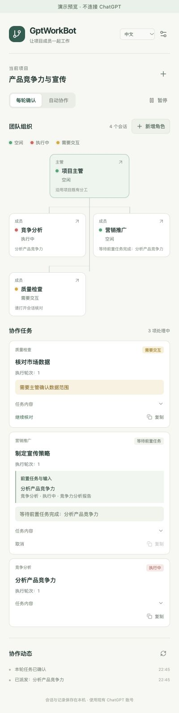
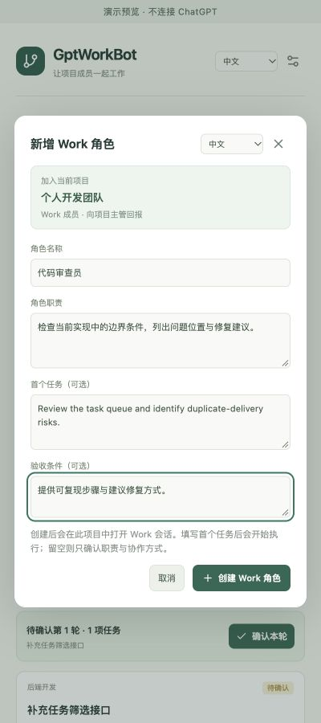

# GptWorkBot · ChatGPT 项目协作

**简体中文** · [English](product-introduction.en.md)

**在一个主管会话中下达目标，让同一项目里的多个 Work 角色协作完成。**

GptWorkBot 是面向个人开发者的 Chrome 浏览器插件。它把已有 ChatGPT 项目中的独立 Work 会话组织成一个可见、可管理的团队：主管拆解任务，成员分别执行，插件传递消息和成果，主管完成验收。

| 项目 | 当前情况 |
| --- | --- |
| 产品版本 | `1.1.0` · 版本测试阶段 |
| 运行方式 | Chrome Manifest V3 扩展，原生侧栏 |
| 适配对象 | 同一 ChatGPT 项目中的独立 Work 会话 |
| 接入方式 | 使用现有登录会话，无需 API Key |
| 语言支持 | 简体中文／English 界面切换，产品与需求文档提供双语版本 |
| 数据保存 | 浏览器扩展本地存储，无独立服务端 |
| 文档基线 | 2026-10-11 · 文档版本 `2.2` |

## 为什么做 GptWorkBot

一个人开发产品时，往往需要同时推进需求、实现、测试和推广。可以为这些工作分别建立 ChatGPT 会话，但继续协作仍需要反复复制任务、切换页面、收集结果和追问进度。

GptWorkBot 将这些步骤放进同一个侧栏，让你继续在主管会话中表达目标，同时看见每个角色的工作状态、待确认任务和协作动态。项目中已有的角色认知、职责、约束和材料继续沿用，插件补充消息路由与任务管理。

插件不要求引入另一个团队工作区或独立付费后台。你仍需已有账号能够访问 ChatGPT 项目和 Work 功能，协作会使用原账号的额度与原生能力。

## 看见整个团队



*这张侧栏截图来自 0.2.0 的本地演示预览，展示依赖等待与任务交互，不包含真实用户会话。*

| 名称旁的状态点 | 表示什么 | 你可以做什么 |
| --- | --- | --- |
| 🟢 绿色 · 空闲 | 空闲或正常等待前置任务 | 继续由主管派发工作 |
| 🔴 红色 · 执行中 | 正在发送、执行或等待当前回复 | 查看任务和原会话进展 |
| 🟡 黄色 · 需要交互 | 等待确认、草稿处理、原生批准、连接中断等 | 打开详情或原会话处理 |
| ⚪ 灰色 · 状态未知 | 页面未连接、状态过期或输入区不可用 | 重新核对会话 |

每个角色还会显示当前任务或连接阶段，例如“等待会话加载”“已送达，等待就绪回复”和“等待前一角色完成就绪确认”。未连接的页面不会被误报为空闲。

## 一句话规划整条任务链

> 分析当前产品竞争力、对比竞品优劣势，再让营销基于已验收分析成果制定宣传策略。请预先规划依赖关系。

竞争分析 → 完整成果回传主管 → 当前轮次验收 → 营销收到分析成果 → 制定宣传策略 → 主管验收汇总。

用户一次确认整轮计划。无依赖任务可并行；有依赖的部门保持空闲，等待所有前置任务的当前完整成果回传主管并通过验收。下游首次消息自动包含完整报告、原会话和执行轮次。

验收不通过时，主管指导原任务修订，执行轮次递增；后续继续等待，旧成果和迟到验收不能解锁。发送重试保留相同输入快照和发送标识。待确认时可调整前置任务并检查循环，批准后关系固定。

## 核心功能

| 功能 | 带来的体验 |
| --- | --- |
| 中英文界面 | 侧栏及新增角色表单可切换语言，记住偏好；用户内容保留原文 |
| 团队组织图 | 主管居上、成员居下，名称旁显示状态点 |
| 绑定已有会话 | 从 Work 读取所属项目名称，单独或批量加入；重复地址合并并优先显示会话名称 |
| 侧栏直接新增角色 | 填写名称、职责和可选首个任务，加入当前项目 |
| 名称与职责同步 | 首次消息包含完整职责，原生 Work 会话标题同步为角色名称 |
| 任务审核与派发 | 按轮确认，支持编辑、取消尚未启动的任务 |
| 任务依赖与成果传递 | 一次批准整条链，等待回传与验收，自动传入完整成果；修订保留历史 |
| 成果回传与验收 | 收集成员结果，交给主管验收，也支持用户确认验收 |
| 自动协作 | 默认最多连续 5 轮，成员并发默认 2、可设为 1–4 |
| 连接与恢复 | 先准备页面，再逐个确认初始化；识别答复中断与不确定发送 |
| 漏读计划提示 | 显示未登记原因；重新读取当前主管计划为待确认草稿，避免重复派发 |
| 草稿保护 | 保留用户输入，核对明确未发送的插件草稿后接续 |
| 暂停、停止与解绑 | 暂停后续消息，进入原会话处理执行状态，本地移除角色 |

### 新角色直接加入当前项目



*角色表单截图沿用 0.1.8 的样例预览；0.2.0 创建控件保持一致。*

点击“新增角色”，填写名称和职责即可提交创建请求。表单明确显示加入的当前项目，首个任务可以留空，让角色先确认就绪、等待后续安排。

没有主管时，可以先创建第一个主管；已有主管后，继续增加成员。新角色的名称和完整职责会进入初始化消息，原生会话标题也会同步为角色名称。创建遇到中断时，插件核对原创建页面和消息回执，避免重复新建会话。

### 页面准备与任务运行有不同阶段

连接协作时，插件复用已有页面，并等待浏览器加载和输入区就绪。主管优先连接，健康的初始化回合逐个确认，减少同时启动多个回合的请求峰值。业务任务继续遵守设置的成员并发数。

页面就绪与发送控件各有最长 15 秒的等待检查。这个时间不限制 Work 执行任务：已送达后仍需等待原生最终回复。发送结果不确定时先核对回执；页面出现“连接已中断，正在等待完整答复”时显示黄色提示，不自动重复发送已有消息。

## 适合哪些工作

| 场景 | 示例角色 | 协作方式 |
| --- | --- | --- |
| 个人软件开发 | 项目经理、软件开发、质量检查 | 拆解需求、完成实现、核对成果并验收 |
| 产品发布准备 | 项目经理、内容编辑、营销推广 | 分别整理产品资料与推广内容，再统一检查 |
| 方案评审 | 主管、方案设计、审查成员 | 独立分析，汇总疑问，由主管决定下一步 |

角色名称与职责由你定义。插件负责会话间的协调，实际执行能力取决于每个原生 Work 会话可用的上下文、工具与权限。

## 开始使用

0.2.1 修复原生文件引用引号未转义导致的成员回报解析失败，保留现有 v2 团队和任务。重载后重新核对出错会话，可恢复已送达回报，不重跑业务任务。

0.2.0 使用协议 v2 与新存储，不迁移旧任务；升级后重新绑定团队并连接协作。旧存储保留但不派发。第一版不提供任意条件表达式、结构化产物提取或外部文件传输。

1. 获取工程中的 `dist` 构建，或解压 `release/gptworkbot-1.1.0.zip`。
2. 在 Chrome 的 `chrome://extensions` 开启开发者模式，加载含 `manifest.json` 的扩展目录。当前版本的最低浏览器版本为 Chrome 120。
3. 刷新已打开的 ChatGPT 页面，点击 GptWorkBot 图标打开侧栏。
4. 连接项目，绑定已有主管和成员，或通过“新增角色”建立团队。确认参与会话使用 Work 模式。
5. 点击“连接协作”，待角色确认就绪后，在原主管会话下达目标，并在侧栏审核任务与成果。

从源码生成安装目录：

```sh
npm ci
npm run package
```

侧栏右上角可选择中文或 English；新增角色表单也可切换。首次按浏览器语言选择中文或英文，之后保留你的选择。角色名称、职责、任务、成果和原生页面提示保留原文。

构建环境需要 Node.js 20.13 或以上版本。当前通过本地加载分发，尚未发布到 Chrome 扩展商店。

## 数据与运行边界

团队、职责、任务、成果、去重回执及必要的页面状态保存在扩展的 `chrome.storage.local`。工程没有独立服务端，不读取 Cookie、账号密码或 API Key；任务与回报通过普通消息进入你绑定的 ChatGPT 会话，因此会保留在相应的原生会话历史中。

浏览器关闭时，插件停止调度。暂停与解绑管理的是插件后续消息，已经启动的原生任务需要在 ChatGPT 内核对。当前一次管理一组项目团队，其他浏览器、多项目同时运行和成员直接互相派发尚未提供。

GptWorkBot 是独立项目，不是 OpenAI 官方扩展。ChatGPT 网页界面会变化，后台页面也可能休眠或发生答复连接中断；出现异常时侧栏提供状态和人工处理入口。原账号额度、模型回复格式及原生权限仍决定实际运行结果。

## 当前验证情况

截至 `1.1.0` 的工程验证记录，16 个测试文件、302 项自动化测试通过，类型检查、构建和 ZIP 完整性检查通过。覆盖依赖链、修订轮次、输入快照及消息协议、队列、状态、草稿保护、回执恢复、角色创建、命名、初始化调度、语言偏好、所属项目识别与会话地址去重。

已进行真实 Work 页面控件与部分操作验证；“安装扩展 → 主管 → 多个成员 → 回传 → 验收”的完整真实闭环仍待人工验收。当前适合参与版本测试，尚不以生产稳定性作承诺。

进一步阅读：[插件需求文档](requirements.md) · [文档导航](README.md)。
