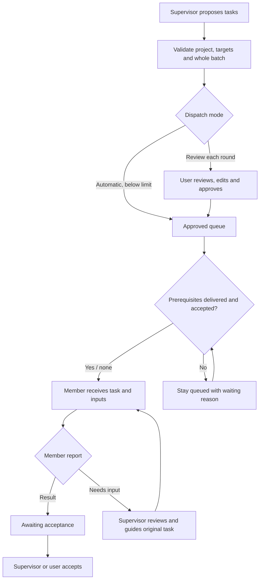

# GptWorkBot extension requirements

[简体中文](requirements.md) · **English**

| Document information | Value |
| --- | --- |
| Document version | `2.3` |
| Product baseline | `1.2.0` |
| Recorded | October 12, 2026 · Asia/Shanghai |
| Target platform | Chrome Manifest V3, minimum Chrome 120 |
| Target users | Individual developers using ChatGPT projects and Work |
| Current phase | Implemented and under version testing; complete real collaboration flow awaiting acceptance |
| Readers | Product, engineering, testing, and project contributors |

This document describes the current implementation and confirmed product requirements. “Implemented” means the code exists; it does not mean every scenario has passed acceptance in a real browser. Future candidates are listed separately and are outside the current delivery.

## 1. Background and goals

Users already maintain roles within a ChatGPT project, where project context establishes awareness and responsibilities. The missing pieces are a shared task queue, result routing, and status visibility between independent conversations. Users currently copy messages repeatedly to coordinate them.

The goal is to let a user express an overall objective to one supervisor. The supervisor proposes tasks using existing responsibilities; the extension coordinates execution, reports, guidance, and acceptance. Preserve the native ChatGPT workflow while reducing page switching, duplicate sending, and ambiguous waiting.

Use a browser extension without a separately paid backend, an API key, or a team-workspace upgrade as an extension requirement. The user’s original account must still provide access to the projects, Work features, tools, and usage capacity involved.

## 2. Scope and roles

### 2.1 Current scope

| Area | Baseline |
| --- | --- |
| Team | One supervisor and multiple members in one connected project |
| Conversations | Independent native Work conversations, bound from existing chats or created as new roles |
| Interface | Native Chrome side panel, organization chart, member details, task cards, and activity |
| Coordination | Supervisor dispatches; members report; cross-member requests require supervisor review |
| Control | Per-round approval, bounded automatic collaboration, pause, and native stop entry |
| Data | Extension local persistence without a separate backend |
| Languages | Simplified Chinese and English interface, product introduction, and requirements |

The current delivery excludes simultaneous multi-project scheduling, multiple supervisor levels, direct peer dispatch, cross-device sync, API executors, and unattended cloud scheduling.

### 2.2 Permissions by role

| Role | Allowed responsibilities |
| --- | --- |
| User | Connect projects, manage roles, edit and approve tasks, change mode, pause, recheck, unbind, and accept results |
| Supervisor conversation | Propose dispatch, member creation, guidance on an existing task, and result acceptance |
| Member conversation | Execute delivered tasks; report results or requests needing supervisor action |
| Extension | Validate protocol and ownership, maintain queues, send and reconcile messages through native pages, and present status |

Member content is material for the supervisor to evaluate. Supervisor operations emitted by a member, claims to another member’s task, and collaboration instructions inside quotations must not directly enter the dispatch queue.

## 3. Main user flows

### 3.1 Connect an existing team

1. Open a project, then read or enter its home URL in the sidebar.
2. Select conversations individually or in a batch, designate one supervisor, and confirm all participants use Work mode.
3. Connect collaboration: reuse or prepare pages and wait for native page and composer readiness.
4. Initialize one role at a time, starting with the supervisor; confirm connection after its matching final reply.
5. Give the supervisor a goal in its native conversation and proceed to review and dispatch.

### 3.2 Add a role

1. Click “Add role” under “Team structure”; the form shows the current project.
2. Enter a name, responsibilities, and an optional member first task and acceptance criteria.
3. Create the first supervisor if none exists; otherwise create a member.
4. Place creation in the approved queue; leave it queued while paused.
5. Create a Work conversation in the current project and send its name and full responsibilities.
6. Bind using the original receipt and permanent conversation URL, then synchronize the native title.
7. Sync the new member’s route to the supervisor.

### 3.3 Execute and collaborate

### 3.4 Recover from exceptions

Determine whether a message was delivered before allowing another send. Clearly unsent tasks return to the queue after an explicit “Retry send.” Delivered or uncertain tasks first read the original receipt and final reply. Native permission, usage-limit, login, or reply-interruption conditions provide an entry to the original conversation.

## 4. Functional requirements and acceptance criteria

P0 covers the current core flow and duplicate prevention. P1 covers implemented efficiency and experience features. P2 is reserved for future candidates.

| ID | Priority | Feature | Status |
| --- | --- | --- | --- |
| FR-01 | P0 | Project and conversation connection | Implemented |
| FR-02 | P0 | Organization chart and status observation | Implemented |
| FR-03 | P0 | Sidebar creation, names, and responsibilities | Implemented |
| FR-04 | P0 | Page preparation and collaboration initialization | Implemented |
| FR-05 | P0 | Supervisor instruction and member report validation | Implemented |
| FR-06 | P0 | Task review, queues, and dispatch | Implemented |
| FR-07 | P1 | Bounded automatic collaboration | Implemented |
| FR-08 | P0 | Result routing, guidance, and acceptance | Implemented |
| FR-09 | P0 | Draft protection, receipts, and duplicate prevention | Implemented |
| FR-10 | P0 | Disconnection, interruption, and recovery | Implemented |
| FR-11 | P0 | Pause, stop, and unbind | Implemented |
| FR-12 | P0 | Local data and access scope | Implemented |
| FR-13 | P1 | Chinese and English interface and documents | Implemented |
| FR-14 | P0 | Dependencies, frozen inputs and revision attempts | Implemented |

### FR-01 Project and conversation connection

Read the current project, enter its home URL, discover conversations, bind individually, and import a batch. Each bound conversation must have a permanent ID. Users confirm project membership and Work mode.

Acceptance criteria:

- Project home URLs with or without a project name resolve to the same project ID.
- Reading a Work conversation shows its owning project name, never its conversation title; unresolved names prompt manual entry or opening the project home.
- Discovered and open conversations merge by permanent conversation identity across project-name slugs, query parameters, and bare conversation routes. Prefer native conversation names and fall back to the address.
- The first project read immediately shows the batch role list. Select roles, the supervisor, and Work confirmation before connecting. Import stays disabled until connection; successful connection keeps the panel and choices without another read. Failure preserves choices for retry.
- A batch selects exactly one supervisor. Validation failure leaves no partial import.
- Reject bindings with mismatched identity or project; role names must be unique.
- Outstanding tasks block project switching and supervisor identity changes.

### FR-02 Organization chart and status observation

Show the supervisor above members. Dots and text both communicate status. Role details include responsibilities, the current reason, the last check time, and a conversation entry.

| Role status | Display | Criteria |
| --- | --- | --- |
| Idle | Green dot and “Idle” | Valid connection and usable composer, with no sending, running, or unresolved content |
| Running | Red dot and “Running” | This role has a sending/running task or native execution is still active |
| Needs input | Yellow dot and “Needs input” | Native prompts, waiting/uncertain tasks, user drafts, title failures, or other handling needs |
| Unknown | Gray outline dot and “Unknown” | Disconnected, observation older than 45 seconds, or unavailable composer |

Acceptance criteria:

- Use visible native status on the current page; ignore hidden stale controls and other conversations’ prompts.
- Native interruptions and pending prompts take priority over red status. Disconnected or stale pages are not idle.
- Settle initialization/report completion independently of instruction deduplication after the matching final reply, preventing stale running indicators.
- Present role execution and business task status separately. An idle member can still have a result awaiting acceptance.
- Task cards show native interaction reasons even when the internal task stays running pending recovery.

### FR-03 Sidebar creation, names, and responsibilities

New roles default to the current project. A member’s first task is optional. The first supervisor only initializes responsibilities and collaboration; the user gives it goals afterward.

| Field | Requirement |
| --- | --- |
| Role name | Required, trimmed, at most 100 characters; unique among bound and pending roles |
| Responsibilities | Required, at most 20,000 characters; sent in full and retained in details |
| First task | Optional for members, at most 40,000 characters; empty means initialization only |
| Acceptance criteria | Optional for members, at most 4,000 characters |
| Project ID | Captured from the current project when opening the form and checked again on submission |
| Creation request ID | Stable and deduplicated; a lost response or repeated submission must not create another conversation |

Acceptance criteria:

- Show the current project. Reject an old request if the project changes while the form is open.
- Use the locally connected project URL. A model cannot supply an arbitrary creation destination.
- Send the name and complete responsibilities in the first message; show responsibilities in role details.
- Temporary Work URLs cannot serve as routing IDs. Bind only after the original receipt and permanent URL appear.
- Match the native title to the role name. Offer title-only retry on failure without recreating or reinitializing the role.
- Prefer the current conversation’s native rename form, wait for editor state updates, and click “Save”; use the native inline title if no sidebar entry exists. Confirm only when the saved name belongs to the current conversation address and matches the role. Control readiness, editing, and confirmation share one 15-second deadline. Exclude hidden nodes and message content; never take over an existing user editor, menu, or dialog.
- Confirm saved names independently of Work execution. Stale inline editors or cached observations must not override a save confirmation from the target conversation. Names belonging to another role, project, or quotation cannot confirm this role.
- Queue only while paused. A closed creation page must not trigger repeated automatic opening.

### FR-04 Page preparation and collaboration initialization

Schedule page preparation separately from initialization execution. Reuse existing pages first; recognize loading pages through saved tab IDs and pending URLs. Wait for loading and composer readiness before sending routing instructions.

Acceptance criteria:

- Concurrent open requests for one role produce one page; loading and navigation must not cause repeated tabs.
- Initial pages may prepare in parallel. Initialize the supervisor first and allow only one healthy initialization turn at a time.
- A user-message receipt proves delivery; its matching final reply is still required to complete initialization.
- Isolate turns explicitly needing input; other roles can initialize within member concurrency capacity.
- A page-readiness checking window lasts at most 15 seconds. Slow pages retain queued tasks for later page events or reconciliation.
- Show queue and execution stages. Do not add another initialization while the same role has an unfinished one.
- Pause, unbind, cancellation, or URL changes during waiting stop subsequent sending.

### FR-05 Supervisor instruction and member report validation

Use a single `work-team` JSON code block. The supervisor supports `dispatch`, `create`, `resume`, and `accept`. Members report their own task as `completed` or `needs_interaction`.

Complete v2 envelopes labelled `json` retain strict schema and ownership checks. Supervisor dispatch plans always await confirmation, even in automatic mode. Ordinary JSON and historical replies do not dispatch work. A plan skipped by the connection baseline, page turn filter or processed-message filter shows a reason and yellow dot. “Read current plan again” validates the visible final reply and whole batch, rejects registered sources and mixed acceptance/revision actions, and creates unapproved drafts only. Continuing the conversation does not authorize historical dispatches.

Acceptance criteria:

- Process final assistant replies from bound roles only; do not execute thinking, unfinished streams, or ordinary quotations.
- Validate project, unique target, ownership, fields, and operation type. A supervisor round contains at most 12 operations.
- Validate the entire round before enqueuing; an invalid target leaves no partial batch.
- Members cannot dispatch directly to peers or report another member’s task.
- Deduplicate instructions by source message. Loading older turns or reconnecting must not repeat historical dispatch.

### FR-06 Task review, queues, and dispatch

Default to per-round approval and group drafts by round. Support expanding content, editing title/instructions/context/acceptance, editing pending-role responsibilities, and cancelling tasks that have not started.

Acceptance criteria:

- Editing keeps a task in draft. Approval moves it into the approved queue.
- Each conversation processes one task at a time. Member business concurrency defaults to 2 and supports 1–4.
- Native member execution consumes member capacity; the supervisor is excluded from member business concurrency.
- Do not force sends to busy, disconnected, interactive, or user-draft-bearing targets.
- Use background pages for automatic dispatch to avoid moving the user away from the supervisor.
- The extension’s concurrency setting is not a guarantee of platform concurrency capacity.

### FR-07 Bounded automatic collaboration

Automatically queue newly proposed, valid supervisor tasks while automatic mode is enabled. Pause future collaboration at the consecutive-round limit.

Acceptance criteria:

- Default maximum: 5 consecutive rounds. Supported setting range: 1–20.
- Enabling automatic mode does not retroactively approve existing drafts.
- Keep pending tasks and a pause notice at the limit. Resuming resets the current automatic-round counter.
- Initialization and ordinary reports follow their own scheduling rules and are not new automatic dispatch rounds.

### FR-08 Result routing, guidance, and acceptance

Member completion moves a task to awaiting acceptance and forwards its result as an ordinary supervisor message. Unsent reports within a round may be aggregated. For coordination requests, the supervisor reviews the request and guides the original task.

Acceptance criteria:

- Results match a delivered member task. Business tasks finish after supervisor `accept` or manual user acceptance.
- `resume` guides an existing delivered member task that is submitted or awaiting input, targets the current attempt, increments it, and preserves the original ID and result history.
- Do not enqueue duplicate unfinished guidance for the same task. Cancel stale guidance if the original task no longer awaits input.
- Initialization and routing reports are message-management tasks and can settle after matching final replies; business tasks still require results and acceptance.
- Late-loaded results and receipts can recover completion. Do not forward the same result repeatedly.

### FR-09 Draft protection, receipts, and duplicate prevention

Persist sending state before the native operation. Messages carry stable `WT-DELIVERY` tokens; business tasks also carry `WT-TASK` IDs. After a single send click, verify delivery through the native user message.

Acceptance criteria:

- Do not overwrite user drafts. A complete, clearly unsent extension draft matching the current task can resume after retry.
- Reconstruct editor paragraph breaks and empty paragraphs; compare the full text and token again before sending.
- Select a unique send control within the composer’s form or container. Do not force-enable controls or blindly press Enter.
- Wait at most 15 seconds for send controls, clicking as soon as ready. Receipt checking occurs separately; 15 seconds is not an execution deadline.
- Unknown receipts or lost responses after clicking produce uncertain status, without a second automatic click.
- Do not borrow the reply to a subsequent user message when the original reply is missing. Historical baselines must not prevent settling known tasks.

### FR-10 Disconnection, interruption, and recovery

After browser or extension restart, find open tabs by permanent conversation URL. Restore missing content-script receivers within existing host permissions. Present native reply interruptions separately from extension communication failures.

Acceptance criteria:

- Visible native connection-interruption/waiting-for-complete-response prompts produce yellow status and a reason.
- Waiting duration alone does not establish success; delayed replies are not automatically classified as platform throttling.
- “Recheck conversations” reads receipts and replies without automatically resending business content.
- Navigated, closed, or identity-mismatched pages cannot count as the correct target.
- Stop automatic reopening after the user closes a target page. Resume existing tasks through explicit user actions.
- Convert pre-restart `sending` tasks to uncertain and reconcile original receipts instead of assuming they were unsent.
- Settle normally when the interruption disappears and the original reply completes. Preserve delivered records.

### FR-11 Pause, stop, and unbind

Acceptance criteria:

- Pause stops future dispatch and reports; native tasks already started continue according to ChatGPT state.
- Stop requests operate only on the identity-matched original conversation, using native controls and checking their outcome.
- Allow local unbinding for disconnected or busy roles without requiring a successful page receiver response.
- Unbind stops tracking and related future messages while retaining the native conversation, task history, and results.
- Unbinding the supervisor pauses the team. Repeated unbind has no additional side effects.
- Confirm underlying tool completion in the original conversation. Stopping generation alone does not establish business completion.

### FR-12 Local data and access scope

Acceptance criteria:

- Persist team records, tasks, responsibilities, results, deduplication receipts, and necessary observations in extension local storage.
- Reduce cached page text; business instructions and results can still exist in task records.
- Do not read cookies, passwords, or API keys, or upload conversations to a separate third-party service.
- Explain that coordination data becomes ordinary messages in bound native conversation history.
- Serialize persistence transactions. Page readiness waits do not occupy a storage transaction, avoiding concurrent overwrites.
- Local storage is not an encryption claim. Uninstalling or clearing extension storage removes local records.

### FR-13 Chinese and English interface and documents

Acceptance criteria:

- Provide 中文 / English switching in the sidebar and role form. Localize buttons, statuses, forms, system reasons, and activity.
- Use the same preference for generated connection guidance, protocol examples, role creation, task wrappers, prerequisite labels, result routing, revision guidance and progress checks. Preserve names, responsibilities, user instructions and complete results; keep JSON fields and WT identifiers unchanged. Save the full message and language before sending. Switching affects unprepared new messages; prepared retries and restarts reuse the original text and identifier.
- Default to Simplified Chinese or English according to browser language. Save the choice separately and restore it after reload or restart without changing team records or run settings.
- Preserve entered role fields across switching. Names, responsibilities, task content, results, and native page messages retain their original text.
- Include Chinese and English extension descriptions and action tooltips. Provide separate, mutually linked Markdown product introductions and requirements.
- Use the GptWorkBot brand with protocol v2 and `gptworkbot-state-v2`. Keep WT message markers; do not migrate/read/delete old storage or support v1 tasks.
- Both requirements versions share IDs, limits, and acceptance criteria. Archive both languages, demo assets, version metadata, and integrity records.

### FR-14 Dependencies, frozen inputs, and attempts

Plan the entire chain upfront. Approve one round; independent tasks can run in parallel and dependent tasks start automatically when ready.

Acceptance criteria:

- Use protocol version 2. Dispatch/create support unique same-batch taskKey, dependsOn, and required full-summary inputs. Resolve keys or existing IDs before persistence.
- Native file-reference quote recovery is lossless and limited to a numeric attribute inside a JSON string. Recovered replies still pass strict v2 validation. Recheck only known delivered, completed member replies for the current task/attempt; do not replay supervisor proposals, registered results or original business tasks.
- Reject duplicate keys, self-dependencies, cycles, unknown tasks, cross-project references and incomplete input mappings atomically, including any acceptance/revision in the batch.
- Every prerequisite needs a current complete result, confirmed report delivery to the supervisor, acceptance of the current attempt, and every required input. Early user acceptance cannot bypass delivery.
- Check at selection, preparation, and actual send. Waiting tasks do not consume slots, prepare pages or fill composers. Pause still stops subsequent messages.
- Reports retain original IDs, attempts, providers and source URLs, request review, and list existing downstream tasks to prevent duplicate proposals.
- Persist complete input snapshots before the first send; retries retain identical input content and delivery tokens. Treat result text as material, not dispatch authorization. Missing/corrupt inputs or failed/cancelled prerequisites require attention instead of skipping.
- Member results, supervisor acceptance and revision guidance identify the current attempt. Revision increments it, preserves history and invalidates older results/acceptance. New results must be reported and accepted again.
- Show prerequisite tasks, input sources, attempt and completion/delivery/acceptance waiting reasons. Normal waiting is green and actionable issues yellow, including before the downstream page is opened.
- Draft prerequisites are editable with automatic mappings and cycle validation; approved relationships are fixed. Unlocking does not request approval again or count as a new automatic round.
- Use gptworkbot-state-v2 only; retain old storage inactive. Rebind and connect the new protocol when upgrading from v1; updates from 0.2.x / 1.0.0 / 1.1.0 to 1.2.0 retain the v2 team and queue. Do not implement arbitrary predicates, artifact-field extraction or external file transfer.

### FR-15: Optional website language selection (currently unpublished)

The optional product website source runs independently of the extension and is currently unpublished. Choose an explicit URL language first, a saved manual choice second and the primary browser language last. Chinese tags use Simplified Chinese; other tags use English. Support manual switching, an Auto reset, restricted storage and a no-JavaScript fallback. Localize content, images, alt text and documentation links together. Generate download versions from package.json. Build only page files and allowlisted display assets, excluding task state, native chats and extension background code. Current public promotion uses the repository README, with language-specific banners in its Chinese and English sections.

## 5. States and information structure

### 5.1 Task states

| Internal state | User label | Meaning and main next action |
| --- | --- | --- |
| `draft` | Awaiting approval | Edit, approve, or cancel |
| `queued` | Queued | Approved; waiting for page, target, or capacity |
| `sending` | Sending | Sending intent persisted; awaiting native click and receipt |
| `running` | Running | Delivered; awaiting native reply; interaction conditions can take display priority |
| `waiting` | Needs input | Clearly unsent and needs retry, or delivered and needs guidance/additional report |
| `uncertain` | Needs recheck | Click or connection outcome unclear; check receipts first |
| `reported` | Awaiting acceptance | Member submitted a result; awaiting confirmation |
| `accepted` | Accepted | Business result accepted, or initialization/report message settled |
| `cancelled` | Cancelled | Unstarted task cancelled, or future tracking stopped after unbinding |

The basic business flow is `draft → queued → sending → running → reported → accepted`. Recovery does not mean resetting and resending every task.

### 5.2 Data objects

| Object | Required information |
| --- | --- |
| Project | ID, name, home URL |
| Agent | Permanent conversation ID, name, responsibilities, URL, project, supervisor flag, initialization and title-sync state |
| Task | ID, project, plan round, type, sender, target, content, acceptance, status, delivery token, taskKey, dependsOn, inputs, resolvedInputs, attempt, acceptedAttempt, resultHistory |
| Observation | Current URL, connection/running/interaction, composer, draft summary, message identities and turn completion |
| Settings | Dispatch mode, member concurrency, automatic-round limit |
| LanguagePreference | Separately saved `zh-CN` / `en` interface preference |
| Event | Key collaboration action, time, and readable description |

## 6. Non-functional requirements

| ID | Requirement | Acceptance measure |
| --- | --- | --- |
| NF-01 Usability | Main management actions in the native side panel | No horizontal overflow at 400px; forms identify the current project and explain handling |
| NF-02 Accessibility | Status communicated beyond color | Status text, identifiable controls, form labels, and keyboard-operable role dialog |
| NF-03 Waiting feedback | Bounded page checks and clear progress | Separate 15-second page/control windows; distinguish delivered waiting from reply interruption |
| NF-04 Reliability | Preserve receipts, results, and task identity | No blind resend after crashes, late loading, or repeated checks; no repeated opening for a role |
| NF-05 Privacy | Local storage and minimum host scope | Only `https://chatgpt.com/*`; no separate upload service or credential reading |
| NF-06 Maintainability | Separate protocol, state, and page adapter | Strict TypeScript, protocol validation, DOM tests, and simulated Chrome API integration |
| NF-07 Compatibility | Explicit supported environment | Chrome MV3; primary Chinese/English native controls; unknown pages show input-needed/unknown state |
| NF-08 Observability | Reasons and last check are visible | Role details, task cards, and activity explain waiting; unknown does not appear idle |
| NF-09 Bilingual consistency | Chinese/English interface and documents | Persist language preference, preserve user text, and share requirements IDs |

### 6.1 Extension permissions

| Permission | Current purpose |
| --- | --- |
| `sidePanel` | Native sidebar |
| `storage`, `unlimitedStorage` | Local records, task history, and deduplication |
| `tabGroups` | Manage the GptWorkBot tab group |
| `alarms` | Periodic background checks and scheduling |
| `scripting` | Restore local content-script connections within existing ChatGPT host scope |
| `https://chatgpt.com/*` | Discover pages, observe visible state, and operate native conversations |

## 7. Testing and release acceptance

### 7.1 Current validation baseline

For `1.2.0`: all 334 tests across 18 files pass, together with strict type checking, building, and installation ZIP integrity checks.

| Area | Current evidence |
| --- | --- |
| Website language precedence, persistence, fallbacks and isolated deployment artifact | `tests/homepage.test.ts` |
| Supervisor JSON instructions, missed-plan diagnosis and explicit recovery | `tests/supervisor-plans.test.ts` |
| Dependencies, revision attempts, snapshots, atomic graph validation | `tests/dependencies.test.ts` |
| Protocol, role identity, queues, concurrency | `tests/core.test.ts` |
| Initialization/completion settlement, late loading | `tests/completion.test.ts` |
| Work DOM, composer, sending, native interruptions | `tests/adapter.test.ts` |
| Owning project, address deduplication, name priority | `tests/discovery.test.ts`, `tests/content.test.ts` |
| First connection, preserved choices, retry, project switching | `tests/panel-setup.test.ts` |
| Background scheduling, restart, page reuse, creation | `tests/background.test.ts` |
| Page connection, repeated injection, send locks | `tests/connection.test.ts`, `tests/content.test.ts` |
| Creation fields, names and responsibilities | `tests/creation.test.ts` |
| Native title synchronization and retry | `tests/naming.test.ts` |
| Language selection, persistence, display-content protection | `tests/i18n.test.ts` |

Automated tests use simulated DOM and Chrome APIs; they do not replace installed-extension acceptance. Real pages and some native operations have been checked. The complete supervisor/multiple-member collaboration flow still needs manual confirmation.

### 7.2 Installed-extension acceptance checklist

- [ ] Approve analysis → marketing once; marketing starts only after report delivery and current acceptance, receiving the complete report.
- [ ] Reject an analysis result, revise the original task, and verify old results/acceptance cannot release marketing.
- [ ] Check multiple prerequisites, independent parallel work, missing inputs, cancellation, pause and restart in real conversations.

- [ ] Switch 中文 / English in the real extension; confirm the preference survives reload and team/task content stays unchanged.
- [ ] Complete onboarding from installation through a supervisor and two members.
- [ ] Give the native supervisor a goal and send approved tasks to the correct members.
- [ ] Forward member results, accept them, and confirm task completion and role status.
- [ ] Create a sidebar role and verify project membership, complete responsibilities, and matching native title.
- [ ] Verify sequential initialization, page reuse, native interruption, and recovery.
- [ ] Verify draft protection and no duplicate clicks with user drafts, disabled send controls, and lost responses.
- [ ] Recover original tasks/receipts after browser restart and unbind disconnected roles without page connectivity.
- [ ] Confirm real pause, stop-request, and resume behavior matches interface descriptions.

This baseline is for version testing. Complete the flow and record the browser/product environment before assessing a stable release.

## 8. Future candidates

These are proposed next steps, not implemented features or delivery commitments.

| Priority | Candidate | Questions before development |
| --- | --- | --- |
| P1 | Installation and first-connection guidance | Identify frequent blockers after completing real acceptance |
| P1 | Connection diagnostics and waiting statistics | Separate preparation, delivery, reply waiting, and native exceptions |
| P1 | DOM adapter maintenance process | Fixed regression samples, language coverage, and interface-change handling |
| P2 | Team templates and role reuse | Applying responsibilities and interaction with existing project settings |
| P2 | Multi-project management and local export | Isolation, switching behavior, and explicit export scope |
| P2 | Multi-level teams or peer routing | Authorization, message loops, conflicts, and concurrency |
| P2 | Other browsers or extension-store distribution | Sidebar capabilities, permission disclosures, and actual compatibility |

See the [GptWorkBot product introduction](product-introduction.en.md) and [documentation index](README.en.md).
