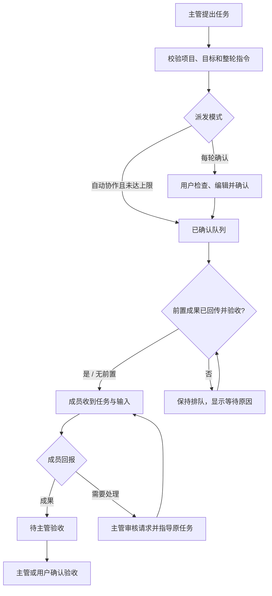

# GptWorkBot 插件需求文档

**简体中文** · [English](requirements.en.md)

| 文档信息 | 内容 |
| --- | --- |
| 文档版本 | `2.1` |
| 产品基线 | `1.0.0` |
| 记录日期 | 2026-10-11 · Asia/Shanghai |
| 目标平台 | Chrome Manifest V3，最低 Chrome 120 |
| 目标用户 | 使用 ChatGPT 项目与 Work 的个人开发者 |
| 当前阶段 | 功能已实现并进入版本测试，完整真实闭环待验收 |
| 阅读对象 | 产品、开发、测试及参与项目的贡献者 |

本文件以当前工程行为和已确认的产品需求为基线。标为“已实现”的功能表示代码中已有实现，不表示全部场景均已完成真实浏览器验收。未来方向单独列出，不计入当前交付。

## 1. 产品背景与目标

用户已经在 ChatGPT 项目中维护多个角色，成员之间的认知与职责也已由项目上下文建立。当前痛点是角色会话间缺少统一任务队列、结果传递和状态观察，需要人工反复复制消息。

产品目标是：用户只向一个主管会话表达总目标，主管按既有分工产生任务，插件协调成员执行、回报、指导与验收。体验应尽量保留原生 ChatGPT 操作方式，减少页面切换、重复发送和不明确的等待。

产品采用浏览器插件，不引入独立付费后台或 API Key，也不将升级团队工作区作为插件自身的使用要求。用户仍需原账号具备所用项目、Work、工具和额度的访问能力。

## 2. 范围与角色

### 2.1 当前范围

| 范围 | 当前基线 |
| --- | --- |
| 团队 | 一个已连接项目中的一位主管与多个成员 |
| 会话 | 独立原生 Work 会话，可绑定已有会话或创建新角色 |
| 操作界面 | Chrome 原生侧栏、组织图、成员详情、任务卡与协作动态 |
| 协调方式 | 主管派发，成员回报，跨成员请求由主管审核 |
| 任务控制 | 每轮确认、有限轮数自动协作、暂停与原生停止入口 |
| 数据 | 扩展本地持久化，无独立后台服务 |
| 语言 | 简体中文与英文界面、产品介绍和需求文档 |

当前不交付多项目同时调度、多层主管树、成员直接互相派发、跨设备同步、API 执行器或无人值守的云端调度服务。

### 2.2 角色权限

| 角色 | 可做什么 |
| --- | --- |
| 用户 | 连接项目、管理角色、编辑及确认任务、切换模式、暂停、核对、解绑和验收 |
| 主管会话 | 提出派发、创建成员、指导原任务、验收成员成果 |
| 成员会话 | 执行收到的任务，回报成果或需要主管处理的请求 |
| 插件 | 验证协议与任务归属，维护队列，经原生页面发送和核对消息，呈现状态 |

成员提供的内容作为资料交给主管判断。成员输出主管操作、冒领其他任务或引用中的协作指令，均不能直接进入派发队列。

## 3. 主要用户流程

### 3.1 接入已有团队

1. 用户打开项目并在侧栏读取或填写项目首页。
2. 单独或批量选择会话，指定一位主管，确认参与会话为 Work 模式。
3. 连接协作：复用或准备会话页面，等待原生页面和输入区就绪。
4. 从主管开始逐个初始化；收到对应最终回复后确认已连接。
5. 用户在主管原会话表达目标，进入任务审核和派发流程。

### 3.2 新增角色

1. 在“团队组织”点击“新增角色”，表单显示当前项目。
2. 填写名称、职责及成员可选的首个任务和验收条件。
3. 无主管时创建首位主管；有主管时新增成员。
4. 创建请求进入已确认队列，暂停期间保留排队。
5. 在当前项目创建 Work 会话，发送名称和完整职责。
6. 按原消息回执及正式会话地址绑定角色，同步原生会话标题。
7. 新成员入组后，将成员路由同步给主管。

### 3.3 执行与协作

### 3.4 异常恢复

先确认消息是否已送达，再决定是否允许发送。明确未发送的任务经用户“重试发送”重新排队；已送达或发送不确定的任务先读取原回执和最终回复。发生原生批准、额度、登录或答复连接中断时，提供进入原会话处理的入口。

## 4. 功能需求及验收标准

优先级定义：P0 是当前核心闭环与防重复行为；P1 是当前已实现的效率或体验能力；P2 仅用于后续方向。

| 编号 | 优先级 | 功能 | 实现状态 |
| --- | --- | --- | --- |
| FR-01 | P0 | 项目与会话接入 | 已实现 |
| FR-02 | P0 | 组织图及状态观察 | 已实现 |
| FR-03 | P0 | 侧栏创建角色、名称与职责同步 | 已实现 |
| FR-04 | P0 | 页面准备与协作初始化 | 已实现 |
| FR-05 | P0 | 主管指令与成员回报校验 | 已实现 |
| FR-06 | P0 | 任务审核、队列及派发 | 已实现 |
| FR-07 | P1 | 有限轮数自动协作 | 已实现 |
| FR-08 | P0 | 成果回传、指导与验收 | 已实现 |
| FR-09 | P0 | 草稿保护、回执及防重复 | 已实现 |
| FR-10 | P0 | 断连、中断与恢复 | 已实现 |
| FR-11 | P0 | 暂停、停止与解绑 | 已实现 |
| FR-12 | P0 | 本地数据及访问范围 | 已实现 |
| FR-13 | P1 | 中英文界面与文档 | 已实现 |
| FR-14 | P0 | 依赖链、输入快照与修订轮次 | 已实现 |

### FR-01 项目与会话接入

支持读取当前项目、填写项目首页、发现项目会话、单独绑定及批量加入。会话必须有正式会话标识，用户需确认属于当前项目并使用 Work 模式。

验收标准：

- 项目首页和带名称的项目地址解析为相同项目标识。
- 在 Work 会话读取项目时显示所属项目名称，不能以会话标题代替；无法识别时提示手动填写或打开项目首页。
- 发现会话与已打开会话按正式会话地址去重，合并项目名称后缀、查询参数及普通会话路径；优先显示原生会话名称，无有效名称时显示地址。
- 首次读取后立即显示批量角色列表，可先选择成员、主管及确认 Work；连接前禁止导入，连接成功后保留面板和选择，无需重新读取。连接失败保留选择并允许重试。
- 批量加入恰好选择一位主管；任一记录校验失败时不留下部分导入。
- 拒绝目标身份或项目不匹配的绑定；成员名称不能与其他角色重复。
- 已有未结束任务时不允许切换项目或变更主管身份。

### FR-02 组织图及状态观察

主管位于上方，成员位于下方。名称旁的点和文字同时表达状态，点击角色进入详情，查看职责、当前原因、最近核对时间和会话入口。

| 角色状态 | 显示 | 判定原则 |
| --- | --- | --- |
| 空闲 | 绿点及“空闲” | 连接有效、输入区可用、无正在发送／运行或待处理内容 |
| 执行中 | 红点及“执行中” | 本角色正在发送或运行任务，或原生页面仍运行 |
| 需要交互 | 黄点及“需要交互” | 原生提示、任务等待／不确定、用户草稿、命名失败等需处理条件 |
| 状态未知 | 灰色空心点及“状态未知” | 未连接、观察超过 45 秒或没有可用输入区 |

验收标准：

- 只依据当前页面的可见原生状态；隐藏旧控件和其他会话提示不参与判定。
- 原生中断或待处理提示优先于红点；断连及过期时不显示空闲。
- 同轮最终回复完成后，初始化／回报结束确认独立于回复指令去重，消除假执行状态。
- 角色运行状态与任务业务状态分别展示；成员空闲时，其成果仍可处于待验收。
- 任务卡同步显示原生需要交互的原因，即使内部任务仍保留运行状态等待恢复。

### FR-03 侧栏创建角色、名称与职责同步

直接创建角色应默认加入当前项目。成员的首个任务可留空；首位主管只初始化职责与协作方式，后续目标由用户在主管会话下达。

| 创建字段 | 要求 |
| --- | --- |
| 角色名称 | 必填，去除首尾空白，最多 100 字符，已绑定及待创建角色均不能重名 |
| 角色职责 | 必填，最多 20,000 字符，完整发送并保存在角色详情 |
| 首个任务 | 成员可选，最多 40,000 字符；留空时只初始化 |
| 验收条件 | 成员可选，最多 4,000 字符 |
| 项目标识 | 取表单打开时的当前项目，提交时再次核对 |
| 创建请求标识 | 稳定、可去重，同一请求的响应丢失或重复提交不能重复建会话 |

验收标准：

- 表单显示当前项目；填写期间切换项目会拒绝旧请求。
- 新页面使用本地已连接项目地址；不能由模型指定任意创建地址。
- 名称和完整职责进入首次消息，职责也在角色详情可见。
- Work 临时地址不能作为成员路由；原回执及正式地址出现后才入组。
- 原生会话标题与角色名称一致；同步失败给出独立重试入口，不重复创建或初始化。
- 标题同步优先操作当前会话菜单中的原生重命名表单，等待编辑状态更新后点击“保存”；侧栏未提供入口时可使用原生行内标题。仅在当前会话地址对应的已保存名称匹配时确认成功；入口等待、编辑与保存确认共用最长 15 秒。隐藏节点和消息正文不作为入口，用户已打开的编辑框、菜单或对话框不被接管。
- 已保存名称的确认不依赖 Work 是否正在执行；旧行内编辑框或旧快照不得覆盖来自目标会话的保存确认。其他角色、项目或引用中的相同名称不能确认当前角色。
- 暂停期间只排队；创建页面关闭后不自动循环补开。

### FR-04 页面准备与协作初始化

页面准备与初始化执行分别调度。已有页面优先复用，加载中的页面按已保存标签编号及待跳转地址复用。先等待浏览器加载完成和原生输入区就绪，再发送协议说明。

验收标准：

- 同一角色的并发打开请求只产生一个页面，加载或跳转过程中不不断新建标签页。
- 首轮可并行准备页面；主管初始化优先，健康的初始化回合一次只启动一个。
- 用户消息送达回执只证明已送达，仍需对应最终回复确认初始化结束。
- 明确需要交互的回合隔离等待；其他角色在成员并发额度内继续初始化。
- 一轮页面就绪检查最长 15 秒；慢页面保留队列，由页面事件或后续核对继续。
- 排队和执行中显示具体阶段；存在同角色未结束初始化时不再次提交初始化。
- 等待期间暂停、解绑、取消或地址变化会中止后续发送。

### FR-05 主管指令与成员回报校验

协作消息使用 version 2 的单个 `work-team` JSON 代码块。主管支持 `dispatch`、`create`、`resume` 和 `accept`；成员回报对应任务的 `completed` 或 `needs_interaction`。

验收标准：

- 只处理已绑定角色的最终助手回复，不执行思考内容、流式未完成内容或普通引用。
- 校验项目、唯一目标、任务归属、字段及操作类型；主管一轮最多 12 项操作。
- 整轮校验成功后才能入队；无效目标不能留下部分任务。
- 成员不能直接向其他成员派发，也不能回报其他成员的任务。
- 回复指令按来源消息去重，加载旧轮次或重新连接不重复派发历史指令。

### FR-06 任务审核、队列及派发

默认每轮确认，待确认任务按轮聚合。支持展开内容、编辑标题／说明／上下文／验收条件，编辑待创建成员职责，并取消尚未启动的任务。

验收标准：

- 编辑后保持待确认，确认后才进入已确认队列。
- 每个会话一次处理一项任务；业务成员并发默认 2，可设为 1–4。
- 成员原生运行也占用成员额度，主管不计入成员业务并发数。
- 忙碌、断连、存在原生交互或用户草稿的目标不被强行发送。
- 自动派发使用后台页面，避免主动切离用户当前主管会话。
- 插件不能将业务并发设置解释为 ChatGPT 平台保证的并发容量。

### FR-07 有限轮数自动协作

开启自动协作后，主管新提出且通过校验的任务可自动排队。达到连续轮数上限后暂停后续协作。

验收标准：

- 默认最多连续 5 轮，设置范围为 1–20 轮。
- 开启自动模式不追认已有未确认草稿。
- 达上限后保留待处理任务和暂停提示；恢复协作重置本次自动轮数计数。
- 初始化和普通回报的调度遵守其自身规则，不被误作新的自动派发轮。

### FR-08 成果回传、指导与验收

成员完成后进入待主管验收，成果以普通消息回传主管；同轮尚未发送的主管回报可聚合。需要协同时，主管审核成员请求并对原任务给出指导。

验收标准：

- 成员成果对应其已送达任务，主管 `accept` 或用户验收后才结束业务任务。
- `resume` 可指导已提交成果或等待处理且已送达的原任务，指向当前 attempt，递增轮次并保留历史。
- 同一原任务不得重复排队尚未结束的指导消息；过期指导在原任务不再等待时取消。
- 初始化和路由回报属于消息管理任务，可按对应最终回复自动结算；普通业务任务仍需成果及验收。
- 成果与回执晚加载时可以恢复结算，同一成果不得反复回传。

### FR-09 草稿保护、回执及防重复

消息发送前持久化状态，携带稳定 `WT-DELIVERY` 标识；业务任务另外携带 `WT-TASK` 标识。单次点击发送后，核对原生用户消息证明送达。

验收标准：

- 不覆盖用户草稿。完整、明确未发送且与当前任务一致的插件草稿可经重试接续。
- 还原多段编辑器中的换行和空段，发送前再次比较完整文本及标识。
- 在输入区所在表单或容器内选择唯一发送控件，不强行启用禁用控件或盲目按 Enter。
- 发送控件最长等待 15 秒，按钮就绪即点击；点击后的回执核对另行进行，不把 15 秒当作执行期限。
- 点击后回执未知或响应丢失时标记不确定，不自动点击第二次。
- 原回复缺失时不能借用下一条用户消息的回复；历史基线也不能阻止已知任务完成结算。

### FR-10 断连、中断与恢复

浏览器或扩展重启后，以正式会话地址找回当前标签页。缺少内容接收端时允许在已有主机权限内恢复页面连接。原生答复流中断与插件通信断连需要分别呈现。

验收标准：

- 原生“连接已中断，正在等待完整答复”等可见状态显示黄点与处理原因。
- 不以等待时长宣告成功，也不将所有答复延迟判定为平台限流。
- “重新核对会话”只读原回执与回复，不自动重发业务内容。
- 已打开但跳转的页面、关闭页和不匹配地址不能被当作正确目标。
- 用户关闭目标页后停止自动补开；按用户明确操作恢复已有任务。
- 重启前的 `sending` 转为不确定，通过原回执核对，不假定未发送。
- 中断提示消失且原回复完成后，可以正常结算；已送达记录保留。

### FR-11 暂停、停止与解绑

验收标准：

- 暂停停止后续派发与回传，已经启动的原生任务仍按 ChatGPT 状态运行。
- 请求停止只作用于目标身份一致的原会话，通过原生停止控件处理并核对结果。
- 断连或仍有任务的角色可以本地解绑，不依赖页面接收端返回成功。
- 解绑停止跟踪与后续相关消息，保留原生会话、任务历史和已有成果。
- 解绑主管自动暂停团队；重复解绑不会产生额外副作用。
- 原生底层工具是否已结束需依据原会话确认，插件不能仅因停止生成就宣告业务完成。

### FR-12 本地数据及访问范围

验收标准：

- 团队、任务、职责、结果、去重回执和必要观察状态保存于扩展本地存储。
- 页面状态缓存缩减会话文本；业务指令和成果仍可能保存在任务记录中。
- 不读取 Cookie、账号密码或 API Key，不向独立第三方服务上传会话。
- 协调信息作为普通消息进入绑定的原生会话，使用说明需明确这一数据去向。
- 持久化事务串行执行，页面等待不占用存储事务，避免状态并发覆盖。
- 本地保存不作为加密承诺；卸载或清理扩展存储会移除本地记录。

### FR-13 中英文界面与文档

验收标准：

- 侧栏与新增角色表单提供中文／English 切换，按钮、状态、表单、系统原因与动态随语言变化。
- 首次使用依据浏览器语言选择简体中文或英文；选择独立存储，刷新或重启后保留，不修改团队记录及运行配置。
- 切换语言保留已输入的角色字段，名称、职责、任务内容、成果及原生提示保留原文。
- 扩展介绍与图标提示有中英文资源；产品介绍和需求文档分别提供可互相导航的中英文 Markdown。
- 品牌统一为 GptWorkBot；采用 v2 协议与 `gptworkbot-state-v2`，保留 WT 标识但不兼容旧任务；旧存储不读取、不迁移、不删除。
- 双语需求使用相同编号、限制与验收口径；归档包含两种语言、演示素材、版本信息及校验记录。

### FR-14 依赖链、输入快照与修订轮次

主管预先规划整条任务链，用户一次批准整轮；无依赖工作可并行，有依赖工作解锁后自动执行。

验收标准：

- 采用 version 2。dispatch/create 支持本批唯一 taskKey、dependsOn 与必需完整 summary 输入；同批键及已有 ID 保存前统一解析。
- 原生文件引用仅允许为 JSON 字符串中的数字索引属性引号补齐转义，保留原文并继续严格 v2 校验。重新核对仅恢复已确认投递、对应最终回复及当前任务／轮次的解析失败回报，不重放主管派发、已登记成果或原业务任务。
- 重复键、自依赖、循环、未知任务、跨项目引用及不完整输入映射整批拒绝；同批验收与修订也不留部分变更。
- 每个前置必须有当前完整成果、回传主管确认送达、当前轮次通过验收及全部必需输入。用户提前验收不能绕过回传。
- 选择、页面准备及实际发送都检查依赖；等待不占槽、不准备页面、不填写消息，暂停仍阻止后续发送。
- 回传保留原任务 ID、attempt、提供部门与原会话，提醒审查并列出已登记后续任务，避免重复派发。
- 首次发送前持久化完整输入快照，重试复用相同内容与发送标识。成果文字只作为资料；输入缺失或损坏、前置失败或取消需要处理，不能跳过。
- 成员回报、验收和指导都指向当前 attempt。修订递增轮次、保留历史、使旧成果及旧验收失效；新成果重新回传和验收。
- 侧栏展示前置任务、输入来源、轮次及等待完成／回传／验收原因；正常等待为绿点，需要处理为黄点，不要求先打开下游页面。
- 草稿可调整前置并自动映射输入、重查循环，批准后固定；依赖解锁不重复确认、不计新自动轮次。
- 仅使用 gptworkbot-state-v2；旧存储保留但不派发，升级重新绑定并连接新版协议。第一版不加入任意条件、产物字段提取或外部文件传输。

## 5. 状态与信息结构

### 5.1 任务状态

| 内部状态 | 用户标签 | 含义与主要出口 |
| --- | --- | --- |
| `draft` | 待确认 | 用户编辑、确认或取消 |
| `queued` | 排队中 | 已确认，等待页面、目标或并发条件 |
| `sending` | 正在发送 | 已记录发送意图，等待原生点击及回执 |
| `running` | 执行中 | 已送达，等待原生回复；交互异常可在界面优先显示 |
| `waiting` | 需要交互 | 明确未发送需重试，或已送达任务需指导／补充回报 |
| `uncertain` | 需要核对 | 点击或连接结果不明，先核对回执 |
| `reported` | 待主管验收 | 成员已提交成果，等待确认 |
| `accepted` | 已验收 | 业务已验收，或初始化／回报消息已完成结算 |
| `cancelled` | 已取消 | 尚未启动的任务取消或解绑后停止后续跟踪 |

基本业务流程为 `draft → queued → sending → running → reported → accepted`。异常恢复不等于把所有任务重置并重新发送。

### 5.2 数据对象

| 对象 | 必需信息 |
| --- | --- |
| Project | 标识、名称、项目首页地址 |
| Agent | 正式会话标识、名称、职责、地址、项目、主管身份、初始化及名称同步状态 |
| Task | 标识、项目、计划轮次、类型、发送方、目标、内容、验收条件、状态、送达标识、taskKey、dependsOn、inputs、resolvedInputs、attempt、acceptedAttempt、resultHistory |
| Observation | 当前地址、连接／运行／交互、输入区、草稿摘要、消息身份与轮次完成信息 |
| Settings | 派发模式、成员并发数、自动轮数上限 |
| LanguagePreference | 独立保存的 `zh-CN`／`en` 界面偏好 |
| Event | 关键协作动作、时间和用户可读说明 |

## 6. 非功能需求

| 编号 | 要求 | 验收口径 |
| --- | --- | --- |
| NF-01 易用性 | 用原生侧栏完成主要管理动作 | 400px 侧栏无横向溢出；表单显示当前项目和可理解的处理说明 |
| NF-02 可访问性 | 状态不只靠颜色表达 | 状态文字、可识别按钮、表单标签；新增角色弹窗可键盘操作和关闭 |
| NF-03 等待反馈 | 有界页面检查，运行过程明确可见 | 页面及控件 15 秒范围独立；已送达等待回复和连接中断有不同文案 |
| NF-04 可靠性 | 优先保留回执、成果和任务身份 | 异常退出、晚加载与重复核对不盲目重发；同角色不循环开页 |
| NF-05 隐私 | 本地保存与最小主机范围 | 主机权限仅 `https://chatgpt.com/*`，无独立上传服务或凭据读取 |
| NF-06 可维护性 | 协议、状态、页面适配分层 | 严格 TypeScript、协议验证、DOM 测试与 Chrome API 模拟集成可运行 |
| NF-07 兼容性 | 明确当前适配环境 | Chrome MV3；中文／英文主要控件；未知页面给出交互或未知状态 |
| NF-08 可观察性 | 可追踪为何等待与最近核对 | 角色详情、任务卡和协作动态包含原因；未知状态不伪装为空闲 |
| NF-09 双语一致性 | 界面与文档支持中文／English | 语言偏好持久化；用户内容保留原文；双语需求编号一致 |

### 6.1 扩展权限基线

| 权限 | 当前用途 |
| --- | --- |
| `sidePanel` | 原生侧栏 |
| `storage`、`unlimitedStorage` | 本地记录、任务历史及去重信息 |
| `tabGroups` | 管理 GptWorkBot 标签组 |
| `alarms` | 后台定期核对与调度 |
| `scripting` | 在已有 ChatGPT 主机范围内恢复本地内容脚本连接 |
| `https://chatgpt.com/*` | 页面发现、可见状态采集与原生会话操作 |

## 7. 测试与发布验收

### 7.1 当前验证基线

截至 `1.0.0` 的工程记录：14 个测试文件、273 项测试通过，严格类型检查、构建及安装 ZIP 完整性检查通过。

| 测试范围 | 当前证据 |
| --- | --- |
| 协议、角色身份、队列和并发 | `tests/core.test.ts` |
| 初始化与任务完成结算、晚加载 | `tests/completion.test.ts` |
| Work DOM、输入区、发送与原生中断 | `tests/adapter.test.ts` |
| 所属项目识别、会话地址去重与名称优先级 | `tests/discovery.test.ts`、`tests/content.test.ts` |
| 首次接入、选择保留、重试与项目切换 | `tests/panel-setup.test.ts` |
| 后台调度、重启、页面复用及创建 | `tests/background.test.ts` |
| 页面连接、重复注入、发送锁 | `tests/connection.test.ts`、`tests/content.test.ts` |
| 创建字段与名称职责 | `tests/creation.test.ts` |
| 原生标题同步及重试 | `tests/naming.test.ts` |
| 语言选择、持久化及显示内容保护 | `tests/i18n.test.ts` |

这些自动化使用 DOM 和 Chrome API 模拟，并不替代真实扩展验收。已有真实页面观察及部分原生操作验证，完整的主管与多成员闭环仍待人工确认。

### 7.2 真实扩展验收清单

- [ ] 一次确认分析 → 营销整条链，营销只在回传及当前轮次验收后启动，收到完整分析。
- [ ] 拒绝分析成果并修订原任务，旧成果／验收不能解锁营销。
- [ ] 真实会话检查多前置汇合、无依赖并行、缺失输入、取消、暂停及重启。

- [ ] 在实际扩展中切换中文／English，刷新后保留偏好且原团队与任务内容不变。
- [ ] 新用户从安装、连接项目到建立主管和两个成员完成闭环。
- [ ] 在原主管会话下达目标，确认任务后分别发送到正确成员。
- [ ] 成员成果回传主管，验收后任务结束且角色状态正确。
- [ ] 通过侧栏创建角色，确认当前项目、完整职责及原生名称一致。
- [ ] 验证角色初始化逐个确认、页面复用、连接中断与恢复。
- [ ] 在用户草稿、禁用发送控件及响应丢失条件下验证不覆盖、不重复点击。
- [ ] 浏览器重启后读取原任务与回执，解绑断连角色不依赖页面连接。
- [ ] 暂停、请求停止及恢复的实际行为与界面说明一致。

当前基线交付版本测试；完成以上闭环并记录浏览器／产品环境后，再评估稳定发布。

## 8. 后续方向

以下为建议的候选工作，尚未实现，也未承诺交付时间。

| 优先级 | 候选方向 | 进入开发前需确认 |
| --- | --- | --- |
| P1 | 安装与首次连接引导 | 完成真实闭环后整理高频阻塞点 |
| P1 | 连接诊断与等待统计 | 区分页面准备、消息送达、回复等待和原生异常 |
| P1 | DOM 适配维护流程 | 固定回归样例、语言范围及界面变更处理规则 |
| P2 | 团队模板与角色复用 | 模板如何应用职责，以及与项目原设置的关系 |
| P2 | 多项目管理及本地导出 | 数据隔离、切换行为和用户明确的导出范围 |
| P2 | 多层组织或成员直连 | 授权边界、消息循环、冲突及并发控制 |
| P2 | 其他浏览器或扩展商店分发 | 侧栏能力、权限说明和实际兼容验证 |

产品介绍见 [GptWorkBot 产品介绍](product-introduction.md)。文档入口见 [文档导航](README.md)。
